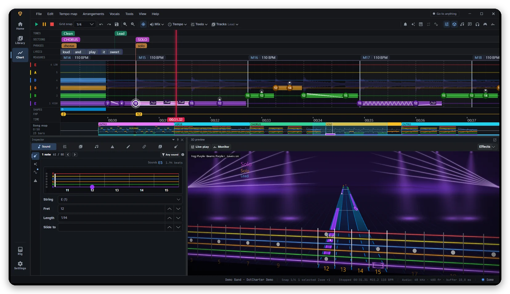
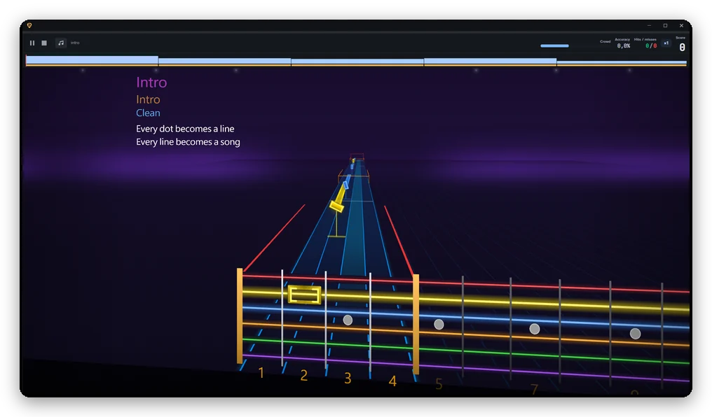
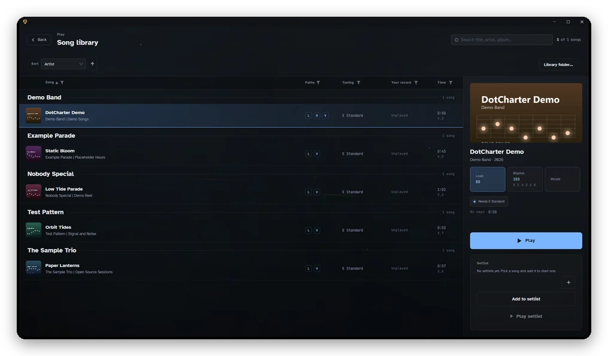
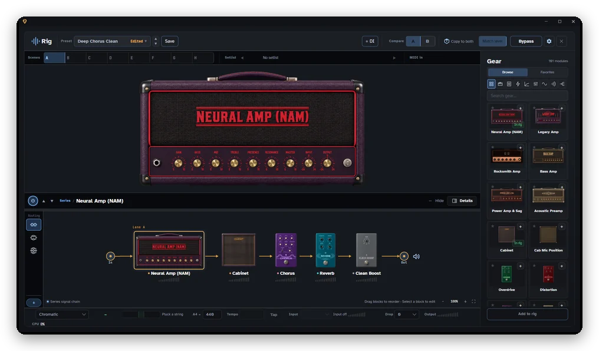
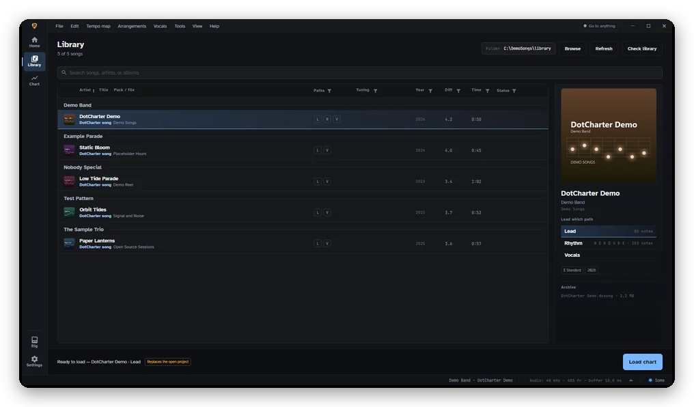
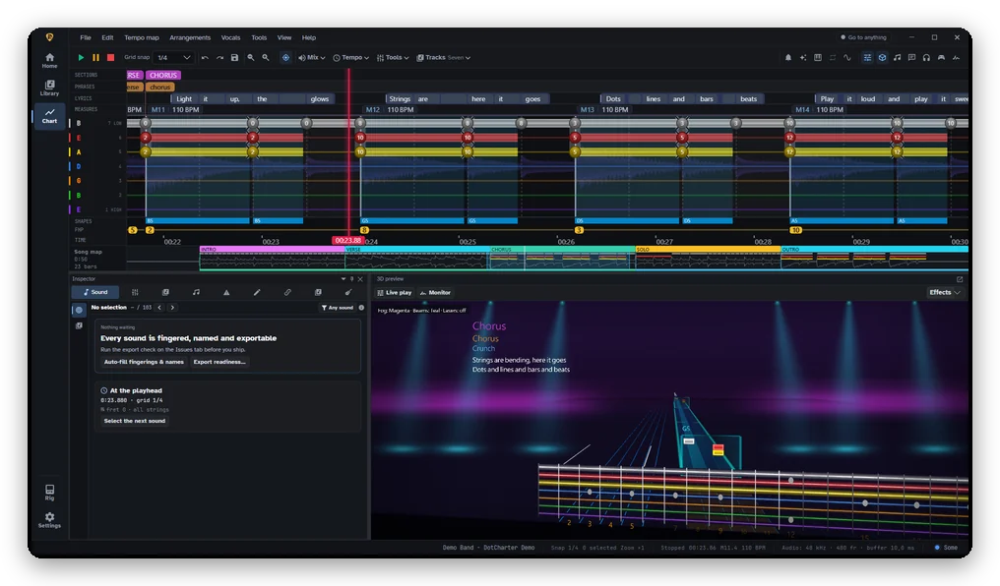
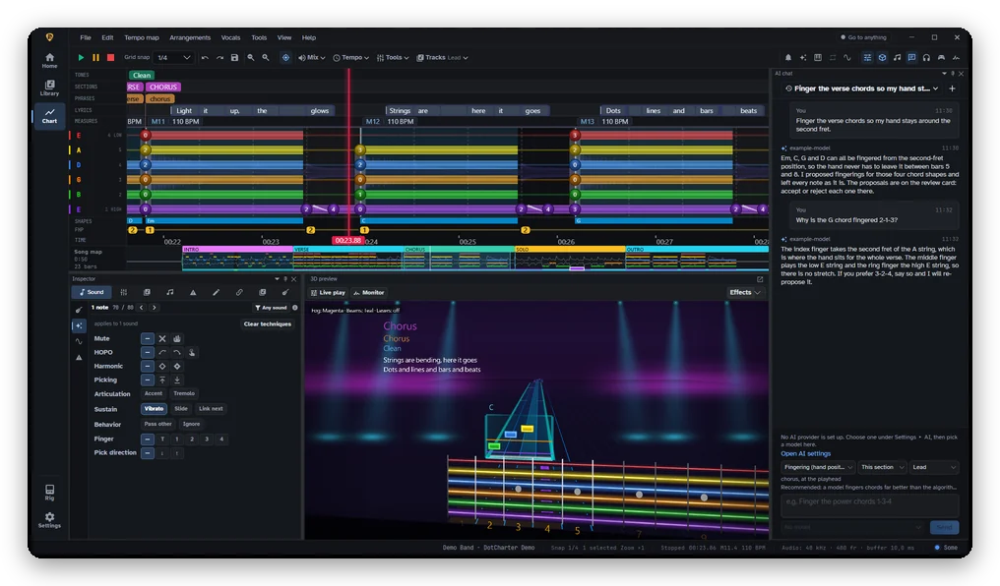
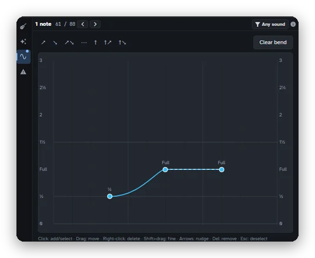
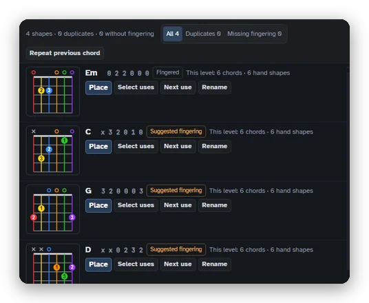
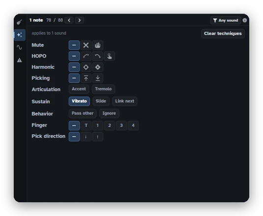

# DotCharter

**A guitar game and a charting workstation for Windows.**
Play your own charts and `.dcsong` songs on a 3D note highway with your real
guitar or bass plugged in, fix the chart in the editor one click away, export
packages with your own keys, and dial in the tone on a built-in amp-and-pedal
rig.

  

DotCharter includes no game content and no songs. It plays and edits the
songs and charts you make with it, and the files you bring yourself.
An optional plugin can extend the library.

---

## Features

<table>
  <tr>
    <td width="50%"> <b>Play</b> the 3D highway with your guitar plugged in.</td>
    <td width="50%"> <b>Song select</b> with your records and setlists.</td>
  </tr>
  <tr>
    <td width="50%"> <b>Tone rig</b> amp, cabinet and pedals on a native DSP engine.</td>
    <td width="50%"> <b>Library</b> every song, arrangement and path at a glance.</td>
  </tr>
  <tr>
    <td width="50%"> <b>7-string</b> charts, edited like any other.</td>
    <td width="50%"> <b>AI assistant</b> proposes fingerings for you to review; it never writes notes.</td>
  </tr>
</table>

<table>
  <tr>
    <td width="33%"> Bends drawn on a curve.</td>
    <td width="33%"> Chord shapes with fingering.</td>
    <td width="33%"> Every technique one click away.</td>
  </tr>
</table>

The pictures show a chart, lyrics, cover and audio made for this README (see
[docs/agents/readme-media.md](docs/agents/readme-media.md)); nothing in them is from a real song.

**Play**
- A scrolling **3D highway** with **live note detection** from your guitar or
  bass: scores, letter grades, per-section results, per-song bests and local
  leaderboards for each player profile.
- Practice tools: a **riff repeater** in the pause menu, A/B loops, a speed
  ladder, dynamic difficulty and a latency-calibration wizard.
- A **tuner** and a **drop tuner** that pitch-shifts the song to your tuning.

**Chart**
- A beat- and tempo-aware **editor** for guitar and bass: keyboard note entry,
  chord templates, hand shapes and fret-hand positions (generated or by hand),
  validators with one-click fixes, checkpoints and chart diff, undo for every
  edit and a command palette (`Ctrl+Shift+P`). Keybinds follow Editor on Fire
  where the two overlap.
- **Chart from audio**: a draft chart and a beat map detected from the song,
  added as a separate arrangement for you to correct.
- **Stem separation** (Demucs and other downloadable models) for practice
  backing tracks; stems are cached per song.
- **Lyric auto-sync**: paste the lyrics and each syllable is timed against the
  vocals.
- A **sheet-music** view synced to the playhead, with PDF export.
- An optional **AI assistant** (your own Claude or OpenAI-compatible endpoint)
  that proposes fret-hand positions, fingerings, chord names and sections for
  you to review. It never writes notes.

**Import and export**
- **`.dcsong`** songs: a chart, its audio, a preview and the cover art (and optionally
  stems) in one file, to play, share and reopen.
- Export of playable Rocksmith 2014 `.psarc` packages with tones and album art,
  encrypted with keys you supply yourself. 7- and 8-string guitar charts export
  in the layout the `rs7string` game mod reads.
- Editor on Fire `.eof`, Guitar Pro (`.gp`, `.gpx`, `.gp5` in; `.gp` out),
  Rocksmith XML, RSCharter `.rscp` and MIDI.
- Projects are saved as `.dcproj` files. Every save also writes a
  Charter-compatible `.rscp` beside it, so the same folder opens in Charter.
  A `.rscp` from Charter or from an older DotCharter opens as before; saving it
  creates the `.dcproj` and keeps the old file.

**Tone rig**
- A pedalboard of amps, cabinets and effects on a native DSP engine, with
  **neural amp captures** (NAM and AIDA-X, 63 bundled), cabinet impulse
  responses, presets and A/B slots.
- Browse and download captures from **TONE3000**, or describe a tone in
  words and let the AI assistant build it.
- Audio I/O over ASIO, WASAPI or DirectSound; VST3 plugin hosting; a
  streaming mirror that sends the mix to a second device for OBS.
- The rig also ships as a standalone app, **RigLab**.

The interface is available in **English, German and Japanese**.

---

## Built on the work of

DotCharter is a newcomer to a community that has charted and shared Rocksmith
custom songs for years, and it works **alongside** that community's tools. It
exists because their authors worked out the formats first. Full detail, with
what we took from each, is in [ACKNOWLEDGEMENTS.md](ACKNOWLEDGEMENTS.md); the
licence texts are in [THIRD-PARTY-NOTICES.md](THIRD-PARTY-NOTICES.md).

- **[Editor on Fire](https://github.com/raynebc/editor-on-fire)** (raynebc).
  We ported its section and event catalogues, follow its rules for arrangement
  properties and repeated chords, and borrowed its keybinds. DotCharter reads
  and writes `.eof`, so a chart can travel both ways.
- **[Charter / Log Charter](https://github.com/Lordszynencja/Charter)**
  (Lordszynencja). The highway textures are Charter's own files, parts of the
  editor logic are ported from it, and its checks are the model for our `L##`
  codes. DotCharter opens its `.rscp` projects and saves a Charter-compatible
  `.rscp` beside every `.dcproj` project.
- **[Rocksmith2014.NET and DLC Builder](https://github.com/iminashi/Rocksmith2014.NET)**
  (iminashi). Parts of our writers are C# ports of its F# code, the tone-gear
  catalogue is its file, and its `I##` checks are our model. DotCharter writes
  a `.rs2dlc` beside the chart so DLC Builder is the next step.
- **[CustomsForge](https://customsforge.com)** and the
  **[Rocksmith Custom Song Toolkit](https://github.com/rscustom/rocksmith-custom-song-toolkit)**
  (rscustom): the community and the long-standing tool whose conventions we
  follow. The `.rs2dlc` we write is shaped for Ignition4's import.

Libraries, models, captures, fonts and recordings are credited in
THIRD-PARTY-NOTICES.md. **If we got your credit wrong, please
[open an issue](https://github.com/SomeeName/DotCharter/issues) and we will fix
it.**

## How DotCharter is made

DotCharter is built with heavy use of AI coding assistants (Claude Code, and
Codex in places) under the direction of one maintainer, who decides what to
build, reviews the results and plays them with a real guitar. What keeps
quality in check: a gate of roughly 20,000 tests, a rule that every change
ships with evidence, source lints, and that review and in-game testing. The
limits are real: AI-written code can be wrong in ways tests miss, so keep your
originals and report anything that looks off. Some rig pictures were generated
with an image model
([THIRD-PARTY-NOTICES.md](THIRD-PARTY-NOTICES.md#3--ai-generated-assets)).

---

## Install and update

1. Download `DotCharter-v<version>-win-x64.zip` from the
   [Releases page](https://github.com/SomeeName/DotCharter/releases).
2. Unzip it anywhere and run `DotCharter.exe`. Nothing else needs to be
   installed: the .NET runtime, ffmpeg and yt-dlp come with it.

The app checks GitHub for new releases (**Settings ▸ Updates**), downloads only
the files that changed and applies the update with one restart, always after
asking you. Settings, profiles and logs live in your user profile, or next to
`DotCharter.exe` if you put an `appconfig.json` there (a portable install).

The same Releases page carries **RigLab** (the standalone tone rig).

New to DotCharter? The [usage guide](docs/guide/README.md) walks through
charting a song and playing one, screen by screen.

## System requirements

- **Windows 10 or 11, 64-bit.** Windows is the only supported platform.
- A **GPU with Vulkan 1.2 drivers** (current NVIDIA, AMD and Intel drivers
  all qualify). The highway and the editor timeline are drawn with Vulkan.
- An audio interface or guitar input for Play Mode and the rig; an **ASIO**
  driver gives the lowest latency.
- **Disk space:** about 550 MB for the installed program (the download is a
  375 MB zip), plus roughly 300 to 360 MB for each stem-separation model you
  download (an optional download, not part of the zip) and room for the stems
  DotCharter caches for your songs.
- Optional: a DirectX 12 GPU makes stem separation much faster (it falls back
  to the CPU otherwise).

---

## Contributing

Bug reports and pull requests are welcome. Read
[CONTRIBUTING.md](CONTRIBUTING.md) first — it covers building from source,
the two test runs and what a pull request needs. Report security problems as
described in [SECURITY.md](SECURITY.md), not as public issues. Taking part
means agreeing to the [Code of Conduct](CODE_OF_CONDUCT.md). The structure of
the code is explained in [docs/ARCHITECTURE.md](docs/ARCHITECTURE.md), and
[docs/adr/](docs/adr/README.md) records why the big decisions were made.
[docs/README.md](docs/README.md) is the index of every guide.

### Development

- [Getting started](docs/dev/GETTING-STARTED.md): clone, build the native
  engine, run the app and the tests. `tools/setup/Bootstrap.ps1` checks your
  machine without changing it.
- [Debugging and diagnostics](docs/dev/DEBUGGING.md): logs, crash reports,
  attaching a debugger and what to include in a bug report.

## Privacy and legal

What the app sends over the network, and when, is listed in
[PRIVACY.md](PRIVACY.md). The contact for rights holders, how a notice is
handled and your responsibility for the audio and charts you import are in
[LEGAL.md](LEGAL.md). DotCharter ships no game content and no keys.

## Support

DotCharter is free. If you'd like to support development, you can do so on [Ko-fi](https://ko-fi.com/A3U028PMFM).

## License

DotCharter is free software under the **GNU General Public License v3.0 or
later** — see [LICENSE](LICENSE); third-party notices are in
[THIRD-PARTY-NOTICES.md](THIRD-PARTY-NOTICES.md) and in the app under
**Help ▸ License & notices**. That file also carries a GPLv3 section 7
additional permission for combining DotCharter with Microsoft DirectML,
the GPU runtime it ships for stem separation.

## Disclaimer

DotCharter is an independent project. Not affiliated with or endorsed by Ubisoft. Rocksmith is a trademark of Ubisoft Entertainment. All other product names are trademarks of their respective owners.
