# Charting a song

A chart is the song written out for one instrument part (an **arrangement**, also called a path:
lead, rhythm or bass). Every note sits on a string at a fret and a point in time, on a **beat map**
that follows the song's tempo. Hand positions, hand shapes, techniques, sections and phrases tell the
player how to play it and split the song into parts.

## The editor

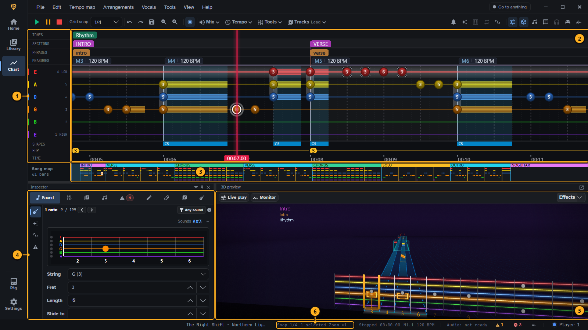

<!-- guide:callouts editor-workspace -->
1. **String labels.** One lane per string. The rows above hold tones, sections, phrases and measures.
2. **Timeline.** The chart: notes as numbered gems on their string, hand shapes and hand positions under them, the red playhead.
3. **Song map.** The whole song with its sections. Click to jump.
4. **Inspector.** Everything about the selection, in tabs. See below.
5. **3D preview.** The highway as a player sees it, at the playhead.
6. **Edit readouts.** Grid snap, how many sounds are selected, and the zoom.
<!-- /guide:callouts -->

### The toolbar

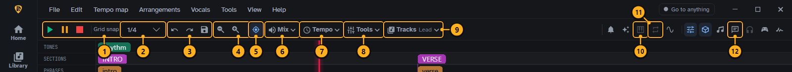

<!-- guide:callouts editor-toolbar -->
1. **Transport.** Play, pause and stop. Space plays and pauses.
2. **Grid snap.** How finely each beat is divided when you place or move notes. T marks triplet grids.
3. **Edit.** Undo, redo and save. Hover undo to see the history.
4. **Zoom.** Zooms the timeline. Ctrl+wheel does the same.
5. **Follow playhead.** Keeps the view on the playhead. Panning turns it off.
6. **Mix.** Song, input and metronome levels.
7. **Tempo.** Playback speed, and the drop-tune pedal.
8. **Tools.** Tuner, MIDI instrument and live effects.
9. **Tracks.** The active arrangement and level, other arrangements as ghosts, and the vocal track.
10. **Play the chart.** Plays the charted notes as a synth, to check them by ear.
11. **Loop.** Loops the marked region.
12. **AI chat.** Shows the AI chat panel.
<!-- /guide:callouts -->

### The Inspector

The Inspector shows what is selected and lets you change it. Its tabs:

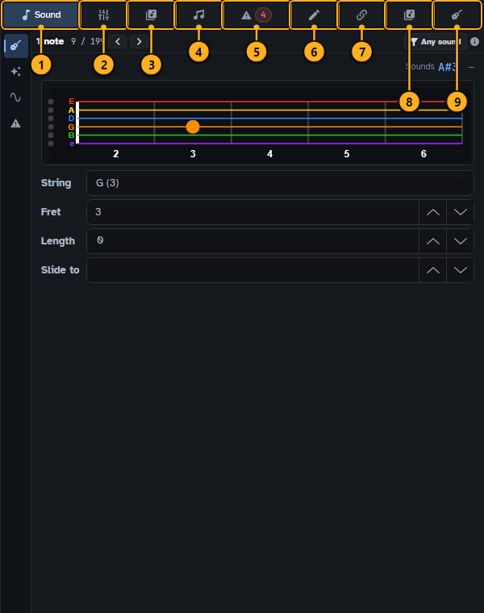

<!-- guide:callouts inspector-tabs -->
1. **Sound.** The selected note, chord or hand shape: string, fret, length, techniques and bends.
2. **Mixer.** Volume, effects, EQ and the MIDI instrument.
3. **Song.** Key signature, and renaming tones, sections and phrases everywhere at once.
4. **Lyrics.** Paste lyrics, then tap each syllable with Ctrl+Space while the song plays.
5. **Issues.** Everything the checker found, export blockers first. Click one to jump to it.
6. **Notes.** Reminders and marks pinned to the timeline.
7. **Phrases.** Every phrase and its repeats; copy one repeat to all others.
8. **Riff library.** Riffs you saved, ready to drop back in.
9. **Chord shapes.** Every chord shape of the arrangement, where it is used, and which lack a fingering.
<!-- /guide:callouts -->

With a **note** selected, the Sound tab shows where it is played:

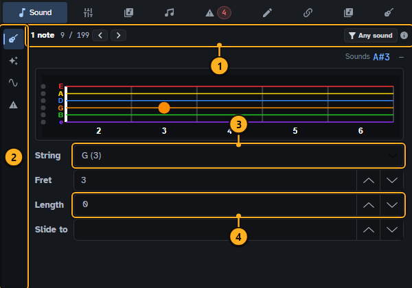

<!-- guide:callouts inspector-note -->
1. **Selection.** What is selected, its position among all sounds, and arrows to step through them.
2. **Sections.** Placement, Techniques, Bends and Findings (what the checker found about this note). Click one to jump to it.
3. **String.** Moves the note to another string; Fret sets the fret below it.
4. **Length.** The sustain, in grid steps. Slide to sets where a slide ends.
<!-- /guide:callouts -->

With a **chord** selected it shows the chord's shape:

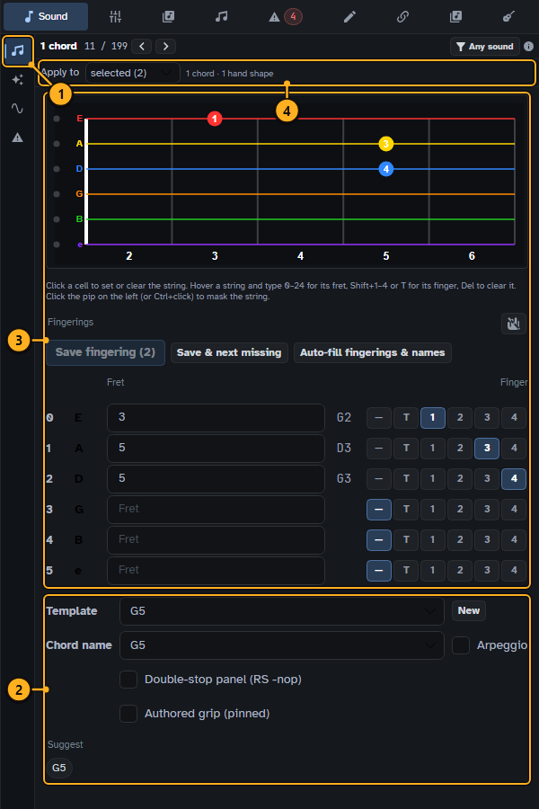

<!-- guide:callouts inspector-chord -->
1. **Shape.** The chord's frets, name and fingering.
2. **Name.** The chord name the player sees.
3. **Fingering.** Which finger holds each string.
4. **Apply to.** Applies the shape to the same chord elsewhere.
<!-- /guide:callouts -->

### The 3D preview

The 3D preview (right of the Inspector in the picture at the top) shows the highway exactly as a
player will see it in Play Mode, at the playhead: notes fly towards the fretboard on their string,
the hand position marks where the fretting hand sits, and chord names and techniques are drawn on the
notes. Use it to check that a passage reads well. **Live play** in its header lets you play along
with your guitar inside the editor and be scored. Show or hide it under **View ▸ Panels ▸ 3D
preview**.

## Walkthrough: from audio to an exported chart

### 1. Import the audio

1. **File ▸ New project…** Choose the song's audio file and fill in title, artist and the
   arrangement's tuning. DotCharter copies the audio into the project folder.
2. For an existing project without audio, use **File ▸ Attach audio…**
3. If you already have a chart in another format, use **File ▸ Import** instead (Guitar Pro, Editor on
   Fire, arrangement XML or MIDI). **File ▸ Chart from audio (draft)…** writes a first draft of the
   notes from the audio for you to correct.
4. Save with **File ▸ Save project** (Ctrl+S).

### 2. Build the beat map

Everything snaps to beats, so the beat map comes first.

1. Play the song (Space) and watch the beat lines on the timeline. If they drift from the music, use
   **Tempo map ▸ Align to recording…** to fit the beats to the audio.
2. Fix single beats with **Tempo map ▸ Insert beat at playhead** and **Remove beat at playhead**, or
   set one tempo for everything with **Set BPM for all measures…**
3. If the song needs a lead-in, add it under **Tempo map ▸ Start & end**.
4. When the beats are right, **Tempo map ▸ Lock beat map** so no later edit moves them.

### 3. Place notes, chords and techniques

1. Pick the arrangement to work on in the toolbar's **Tracks** panel, and a **Grid snap** that fits the
   passage (1/8 or 1/16 for most riffs).
2. Move the playhead to where a note starts and add it on its string; type the fret number to set it.
   The keys for this are listed under **Help ▸ Keyboard shortcuts…** and can be changed in
   **Settings ▸ Keybinds**. Turn on **Keyboard note entry** in **Settings ▸ Editor** to chart from the
   keyboard alone.
3. Select a note to edit it in the Inspector's **Sound** tab: string, fret, length and slide in
   **Placement**, then hammer-ons, palm mutes, harmonics, vibrato and the rest in **Techniques**, and
   bends in **Bends**.
4. For chords, place the notes that sound together and use **Tools ▸ Chords ▸ Merge notes into
   chord**, or turn a single note into a power chord. Name and finger the chord in the Inspector's
   **Shape** section. **Tools ▸ Hand shapes** creates the hand shapes that show the chord box.
5. **Tools ▸ Fret hand positions ▸ Generate FHP** places the hand positions for the whole arrangement.
   Check them in the 3D preview.
6. Use **Play the chart** in the toolbar to hear the charted notes as a synth against the song.

### 4. Mark sections and phrases

1. Turn on the **Sections** and **Phrases** rows under **View ▸ Rows**.
2. Add a section (intro, verse, chorus, solo…) and a phrase where each part of the song begins. The
   Inspector's **Song** tab renames a section or phrase everywhere at once.
3. **Tools ▸ Structure & levels ▸ Generate structure** adds the COUNT and END phrases for you.
4. **Arrangements ▸ Copy sections & phrases to other arrangements** gives every path the same
   structure.
5. **Tools ▸ Structure & levels ▸ Generate difficulty levels…** builds easier versions of each
   phrase, so players can start simple and level up.

### 5. Check and export

1. Open the Inspector's **Issues** tab, or **Tools ▸ Review ▸ Chart quality report…** Everything that
   would stop the chart from exporting is listed first; click a finding to jump to it, and use **Fix**
   where it is offered. **Tools ▸ Fix & clean up ▸ Auto-fix arrangements** repairs the common faults
   in one step.
2. Fill in the song's details under **File ▸ Song metadata…**
3. Export under **File ▸ Export**: a DotCharter song file to share or play, a Guitar Pro or Editor on
   Fire file, or sheet music as PDF.

## Every menu

The editor's menu bar holds every command. Commands that act on a selection are greyed out until
something is selected. The shortcut, where there is one, is shown on the right of each row.

### File

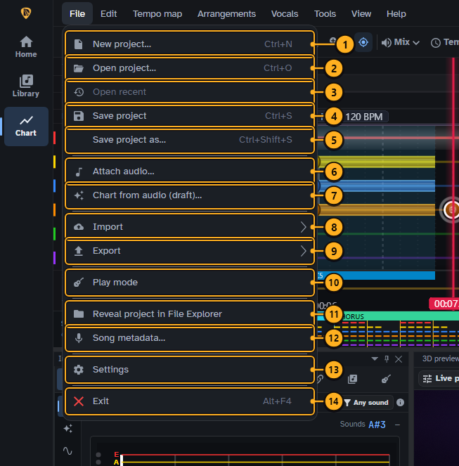

<!-- guide:callouts menu-file -->
1. **New project.** Starts a project from an audio file, with title, artist and tuning.
2. **Open project.** Opens a saved DotCharter project.
3. **Open recent.** The projects you opened last.
4. **Save project.** Saves the project (Ctrl+S).
5. **Save project as.** Saves a copy under a new name or folder.
6. **Attach audio.** Copies an audio file into the project folder and uses it as the song's audio.
7. **Chart from audio.** Detects beats and notes in the audio and writes a draft chart for you to correct.
8. **Import.** Brings in a chart from another format. See the Import submenu below.
9. **Export.** Writes the chart to other formats. See the Export submenu below.
10. **Play mode.** Switches to Play Mode to play the song like a game.
11. **Reveal project.** Opens the project folder in File Explorer.
12. **Song metadata.** Title, artist, album, year and the other song details.
13. **Settings.** Opens the settings.
14. **Exit.** Closes DotCharter and asks about unsaved changes first.
<!-- /guide:callouts -->

#### File ▸ Import

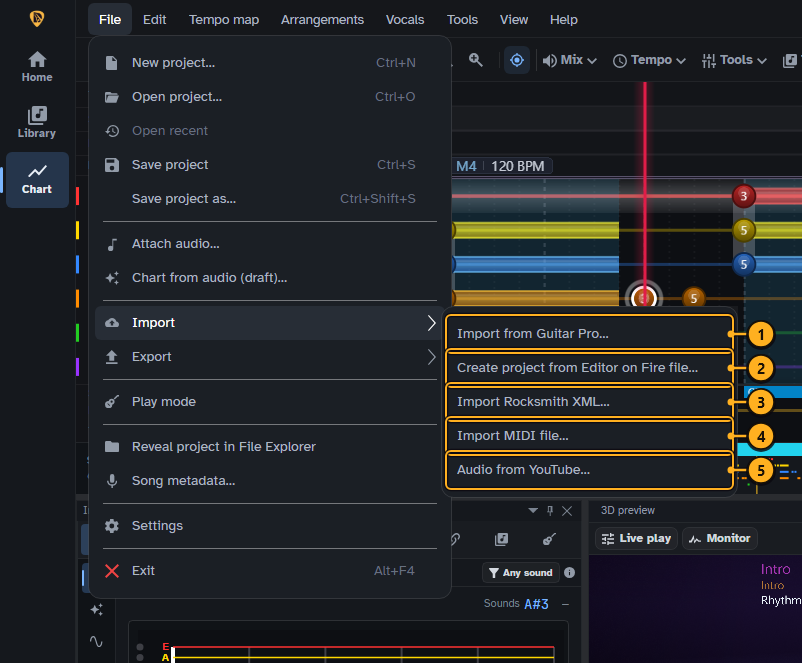

<!-- guide:callouts menu-file-import -->
1. **Guitar Pro.** Imports a Guitar Pro file as arrangements, with tempo and sections.
2. **Editor on Fire.** Creates a project from an Editor on Fire project file.
3. **Rocksmith XML.** Imports an arrangement from a Rocksmith arrangement XML file into the open project.
4. **MIDI file.** Imports notes from a MIDI file.
5. **Audio from YouTube.** Downloads a video's audio and attaches it to the open project.
<!-- /guide:callouts -->

#### File ▸ Export

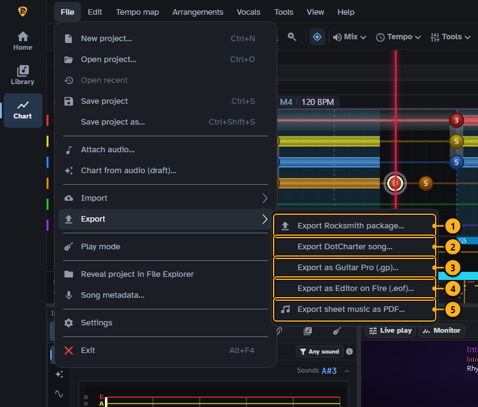

<!-- guide:callouts menu-file-export -->
1. **Rocksmith package.** Builds a custom-song package of the chart, with every arrangement, for the game.
2. **DotCharter song.** Packs the project, audio included, into one song file to share.
3. **Guitar Pro.** Writes the chart as a Guitar Pro file.
4. **Editor on Fire.** Writes an Editor on Fire project.
5. **Sheet music PDF.** Prints the chart as notation and tab to a PDF.
<!-- /guide:callouts -->

### Edit

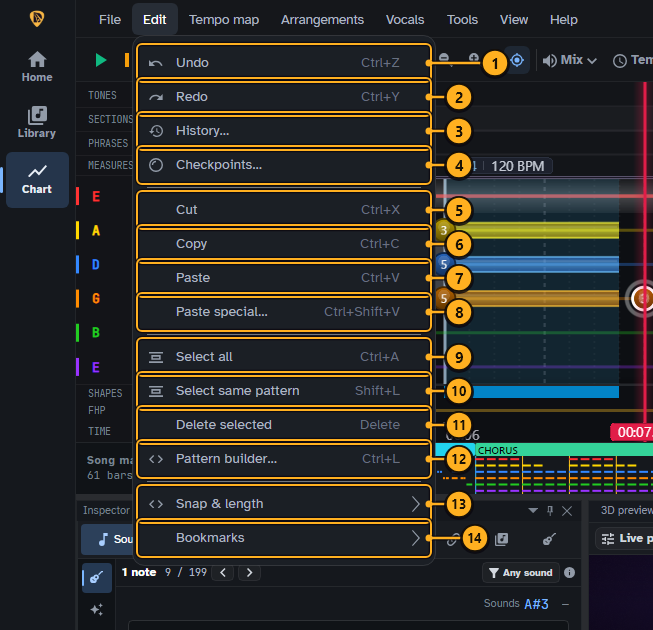

<!-- guide:callouts menu-edit -->
1. **Undo.** Takes back the last edit (Ctrl+Z).
2. **Redo.** Repeats an undone edit.
3. **History.** The list of edits; jump back to any of them.
4. **Checkpoints.** Named snapshots of the project you can return to.
5. **Cut.** Cuts the selection.
6. **Copy.** Copies the selection.
7. **Paste.** Pastes at the playhead.
8. **Paste special.** Chooses what to paste: notes, hand shapes, positions and more.
9. **Select all.** Selects every note and chord of the arrangement.
10. **Select same pattern.** Selects every repeat of the selected pattern.
11. **Delete selected.** Deletes the selection.
12. **Pattern builder.** Builds a repeating pattern of notes and fills a range with it.
13. **Snap & length.** Snaps notes to the grid and changes their length. See below.
14. **Bookmarks.** Ten bookmarks: set one at the playhead and jump back to it.
<!-- /guide:callouts -->

#### Edit ▸ Snap & length

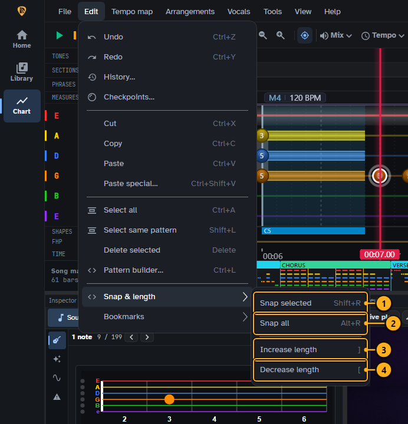

<!-- guide:callouts menu-edit-snap -->
1. **Snap selected.** Moves the selected notes onto the nearest grid line.
2. **Snap all.** Snaps every note of the arrangement.
3. **Increase length.** Makes the selected sustains one grid step longer.
4. **Decrease length.** Makes them one grid step shorter.
<!-- /guide:callouts -->

**Edit ▸ Bookmarks** holds the ten bookmarks, 0 to 9: each row jumps to its bookmark.

### Tempo map

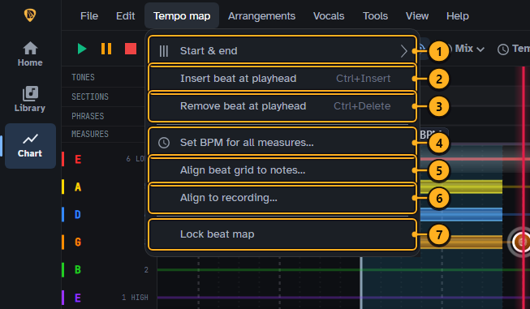

<!-- guide:callouts menu-tempo-map -->
1. **Start & end.** Adds silence or measures before the first or after the last beat. See below.
2. **Insert beat.** Adds a beat at the playhead.
3. **Remove beat.** Removes the beat at the playhead.
4. **Set BPM.** Sets one tempo for every measure.
5. **Align beat grid.** Moves the beat grid so it lines up with the charted notes.
6. **Align to recording.** Fits the beat map to the audio's own beats.
7. **Lock beat map.** Protects the beats from being moved by accident.
<!-- /guide:callouts -->

#### Tempo map ▸ Start & end

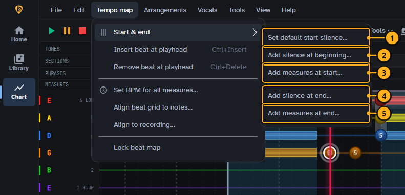

<!-- guide:callouts menu-tempo-map-start-end -->
1. **Default start silence.** Sets the standard lead-in before the first beat.
2. **Silence at beginning.** Adds silence before the song starts.
3. **Measures at start.** Adds empty measures before the first beat.
4. **Silence at end.** Adds silence after the song.
5. **Measures at end.** Adds empty measures after the last beat.
<!-- /guide:callouts -->

### Arrangements

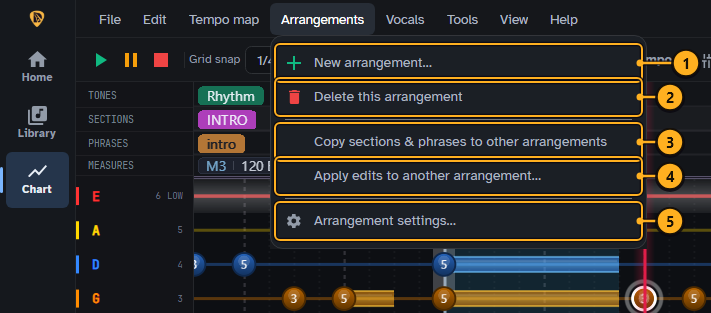

<!-- guide:callouts menu-arrangements -->
1. **New arrangement.** Adds a lead, rhythm, bass or other path to the song.
2. **Delete arrangement.** Removes the active arrangement.
3. **Copy sections & phrases.** Copies this arrangement's section and phrase markers to every other one.
4. **Apply edits to another.** Copies hand positions, fingerings and hand shapes where two arrangements play the same notes.
5. **Arrangement settings.** Name, type, tuning, capo and string count.
<!-- /guide:callouts -->

### Vocals

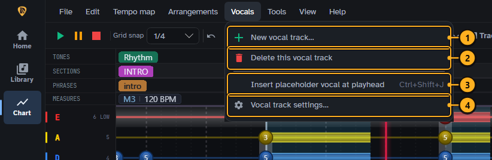

<!-- guide:callouts menu-vocals -->
1. **New vocal track.** Adds a lyrics track.
2. **Delete vocal track.** Removes the active vocal track.
3. **Insert vocal.** Adds a placeholder syllable at the playhead.
4. **Vocal track settings.** Name and options of the vocal track.
<!-- /guide:callouts -->

### Tools

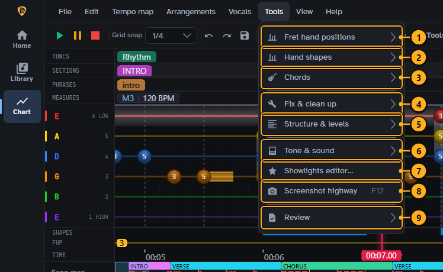

<!-- guide:callouts menu-tools -->
1. **Fret hand positions.** Generates the hand positions the highway shows.
2. **Hand shapes.** Creates chord and arpeggio hand shapes.
3. **Chords.** Turns notes into chords and back, and switches fingerings.
4. **Fix & clean up.** Repairs and polishes a chart, optionally with AI help.
5. **Structure & levels.** Phrases, sections and difficulty levels.
6. **Tone & sound.** Tuner, tone designer, rig and stem separation.
7. **Showlights editor.** Edits the stage lights that play with the song in the 3D view.
8. **Screenshot highway.** Saves a picture of the 3D highway.
9. **Review.** Quality report, comparison and library-wide checks.
<!-- /guide:callouts -->

#### Tools ▸ Fret hand positions

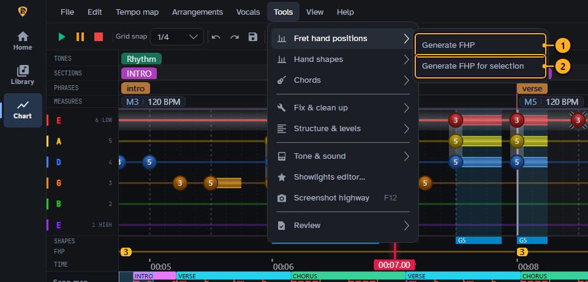

<!-- guide:callouts menu-tools-fhp -->
1. **Generate FHP.** Places fret-hand positions over the whole arrangement.
2. **For selection.** Does the same for the selected notes only.
<!-- /guide:callouts -->

#### Tools ▸ Hand shapes

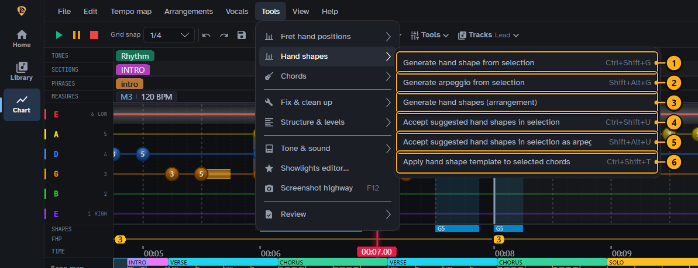

<!-- guide:callouts menu-tools-hand-shapes -->
1. **From selection.** Makes a chord hand shape over the selected notes.
2. **Arpeggio.** Makes an arpeggio hand shape over the selected notes.
3. **Whole arrangement.** Generates hand shapes for every chord.
4. **Accept suggestions.** Turns the dashed suggested shapes in the selection into real ones.
5. **Accept as arpeggios.** The same, as arpeggio shapes.
6. **Apply template.** Applies a hand shape's chord template to the selected chords.
<!-- /guide:callouts -->

#### Tools ▸ Chords

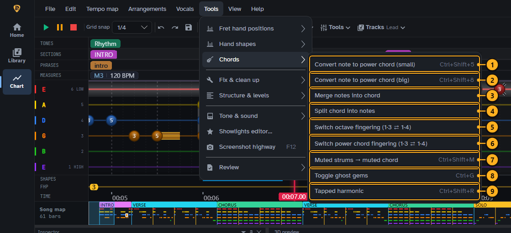

<!-- guide:callouts menu-tools-chords -->
1. **Power chord (small).** Turns a note into a two-string power chord.
2. **Power chord (big).** Turns a note into a three-string power chord.
3. **Merge into chord.** Joins notes at the same time into one chord.
4. **Split into notes.** Breaks a chord into single notes.
5. **Octave fingering.** Switches octave shapes between fingers 1-3 and 1-4.
6. **Power chord fingering.** Switches power chords between fingers 1-3 and 1-4.
7. **Muted strums.** Turns muted strums into a muted chord.
8. **Ghost gems.** Marks notes as held in the chord box but not played.
9. **Tapped harmonic.** Makes the selected notes tapped harmonics.
<!-- /guide:callouts -->

#### Tools ▸ Fix & clean up

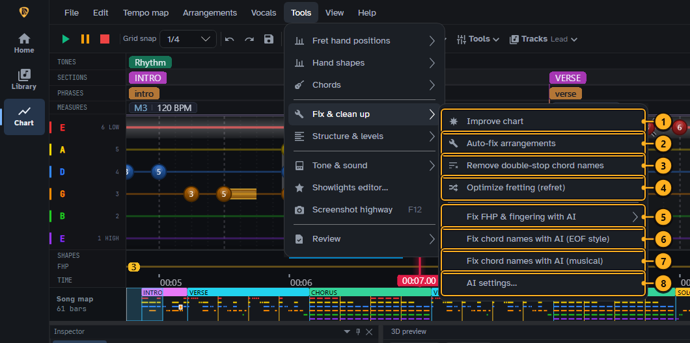

<!-- guide:callouts menu-tools-fix -->
1. **Improve chart.** Polishes a valid chart: trims it to the audio, adds the END phrase and restates hand positions.
2. **Auto-fix.** Repairs what is broken: order, duplicates, lengths, slides and anchors.
3. **Remove double-stop names.** Clears chord names from two-string shapes.
4. **Optimize fretting.** Moves notes to other strings to reduce hand movement.
5. **Fix FHP & fingering with AI.** Asks the AI provider from Settings to correct hand positions, fingerings, or both.
6. **Fix chord names with AI.** Corrects chord names in Editor on Fire spelling.
7. **Musical chord names.** The same, in musical spelling.
8. **AI settings.** Picks the AI provider and model.
<!-- /guide:callouts -->

**Fix FHP & fingering with AI** opens one more level: fingering only, hand positions only, or both
together. The AI rows need a provider set up in **Settings ▸ AI**.

#### Tools ▸ Structure & levels

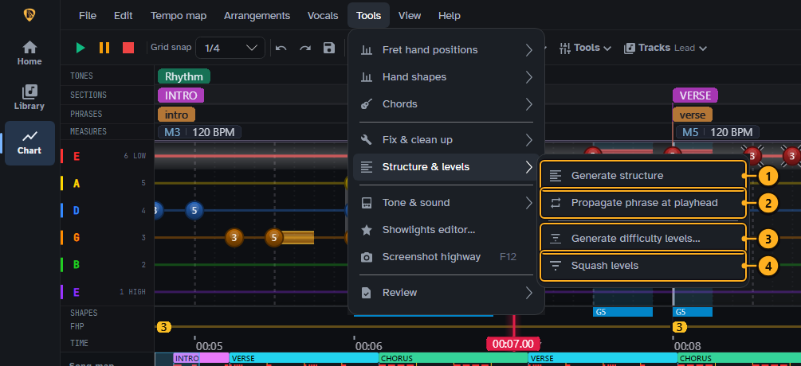

<!-- guide:callouts menu-tools-structure -->
1. **Generate structure.** Adds the COUNT and END phrases and no-guitar sections over silences.
2. **Propagate phrase.** Copies the phrase under the playhead to every repeat of it.
3. **Generate levels.** Builds easier difficulty levels from the hardest one.
4. **Squash levels.** Merges the levels back into one.
<!-- /guide:callouts -->

#### Tools ▸ Tone & sound

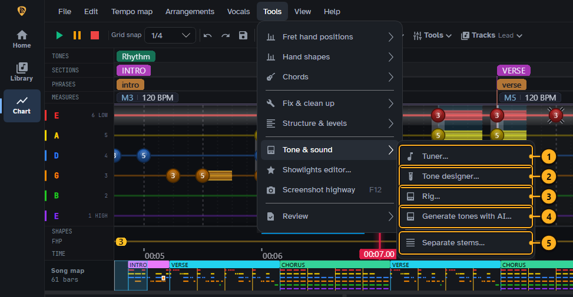

<!-- guide:callouts menu-tools-tone -->
1. **Tuner.** Tunes your instrument to the arrangement's tuning.
2. **Tone designer.** Edits the tones the song switches between.
3. **Rig.** Opens the tone rig.
4. **Generate tones with AI.** Asks your AI provider for one tone per tone change.
5. **Separate stems.** Splits the audio into guitar, bass, drums and vocals, so you can mute your part.
<!-- /guide:callouts -->

#### Tools ▸ Review

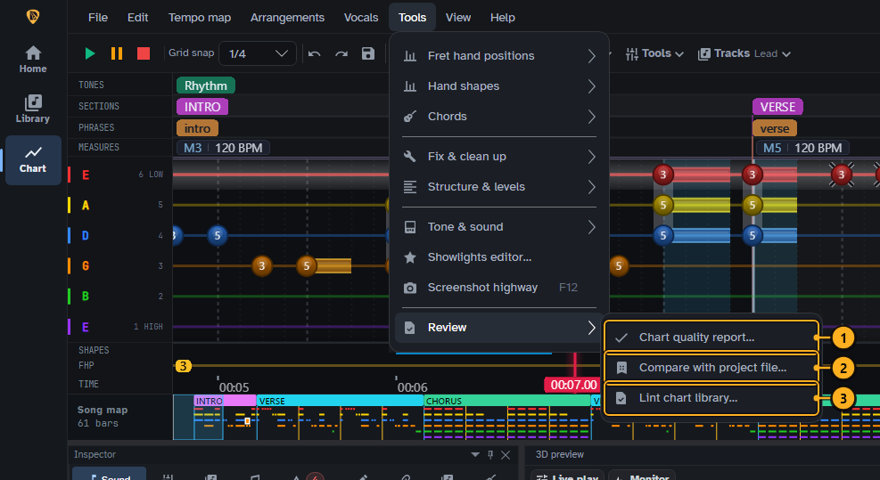

<!-- guide:callouts menu-tools-review -->
1. **Chart quality report.** Every check in one list, with Go to and Fix for each finding.
2. **Compare with project file.** Shows what differs between the open chart and a saved one.
3. **Lint chart library.** Checks every project in a folder and can fix them.
<!-- /guide:callouts -->

### View

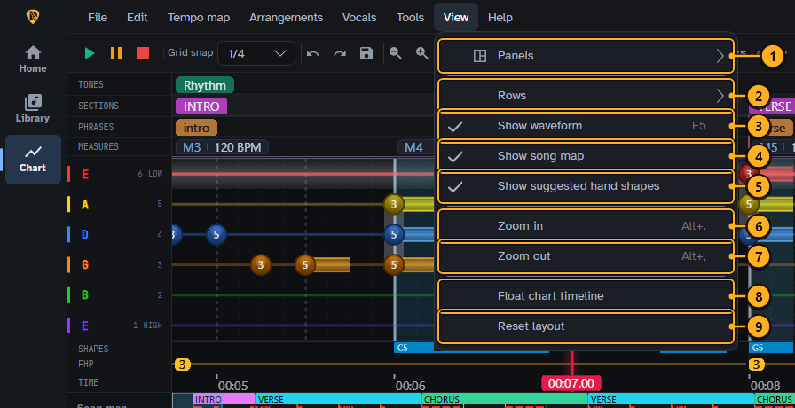

<!-- guide:callouts menu-view -->
1. **Panels.** Shows or hides the editor's panels. See below.
2. **Rows.** Shows or hides the rows above the strings. See below.
3. **Show waveform.** Draws the audio waveform behind the notes.
4. **Show song map.** The overview strip of the whole song under the timeline.
5. **Suggested hand shapes.** Shows dashed hand-shape suggestions.
6. **Zoom in.** Stretches the timeline.
7. **Zoom out.** Shows more of the song.
8. **Float chart timeline.** Moves the timeline into its own window.
9. **Reset layout.** Puts every panel back where it started.
<!-- /guide:callouts -->

#### View ▸ Panels

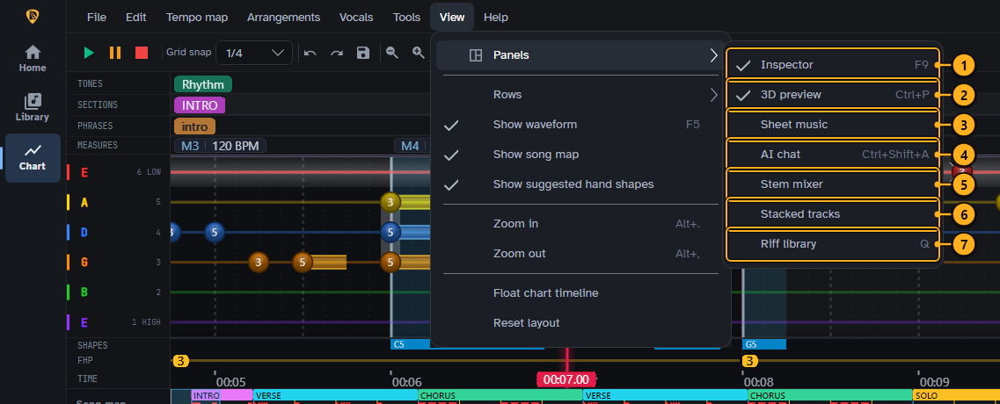

<!-- guide:callouts menu-view-panels -->
1. **Inspector.** Properties of the selection.
2. **3D preview.** The highway as a player sees it.
3. **Sheet music.** Notation and tab under the timeline.
4. **AI chat.** Ask an AI assistant about fingering, hand positions and sections.
5. **Stem mixer.** Levels of the separated stems.
6. **Stacked tracks.** The other arrangements, stacked under this one.
7. **Riff library.** Saved riffs to drop back into a chart.
<!-- /guide:callouts -->

#### View ▸ Rows

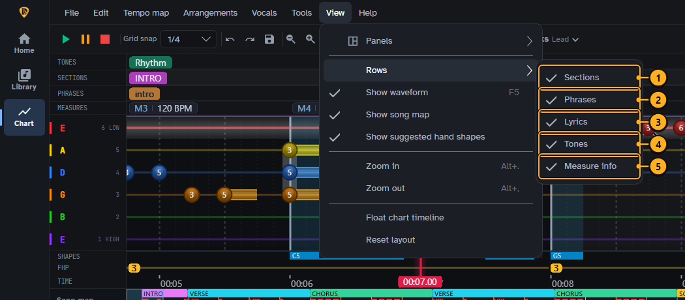

<!-- guide:callouts menu-view-rows -->
1. **Sections.** The section row (intro, verse, chorus...).
2. **Phrases.** The phrase row.
3. **Lyrics.** The lyrics row.
4. **Tones.** The tone-change row.
5. **Measure info.** Measure numbers, tempo and time signature.
<!-- /guide:callouts -->

### Help

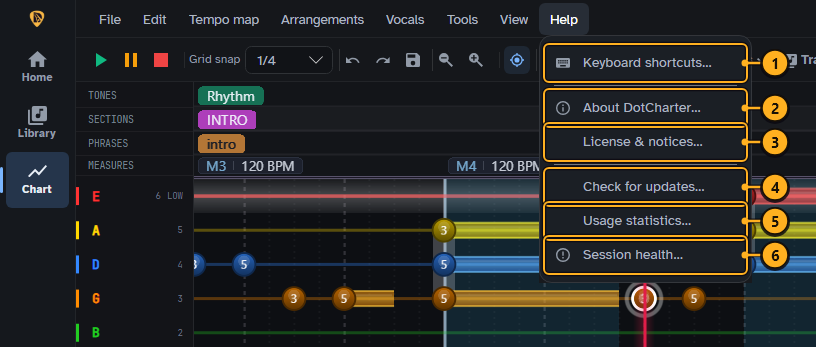

<!-- guide:callouts menu-help -->
1. **Keyboard shortcuts.** Every shortcut, searchable.
2. **About.** Version and credits.
3. **License & notices.** The licence and third-party notices.
4. **Check for updates.** Looks for a newer release.
5. **Usage statistics.** Writes a local report of the commands you use. Nothing is uploaded.
6. **Session health.** Rendering and audio diagnostics, and a bundle to attach to a bug report.
<!-- /guide:callouts -->

Next: [Playing a song](playing.md).
