# Charting a song

A chart is the song written out for one instrument part. That part is called an **arrangement**, or a
path, and it is lead, rhythm or bass. Every note sits on a string at a fret and a point in time, on a
**beat map** that follows the song's tempo. Hand positions, hand shapes, techniques, sections and
phrases tell the player how to play the part. Sections and phrases also split the song into parts.

## The editor

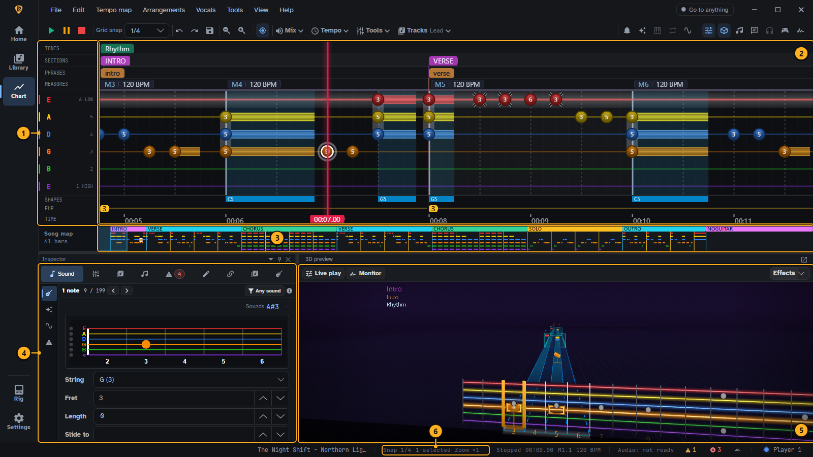

<!-- guide:callouts editor-workspace -->
1. **String labels.** One lane per string. The rows above hold tones, sections, phrases and measures.
2. **Timeline.** The chart. Notes are numbered gems on their string. Hand shapes and hand positions sit under them, and the playhead is red.
3. **Song map.** The whole song with its sections. Click to jump.
4. **Inspector.** Everything about the selection, in tabs. See below.
5. **3D preview.** The highway as a player sees it, at the playhead.
6. **Edit readouts.** Grid snap, how many sounds are selected, and the zoom.
<!-- /guide:callouts -->

### The toolbar

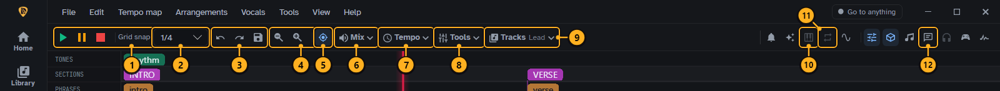

<!-- guide:callouts editor-toolbar -->
1. **Transport.** Play, pause and stop. Space plays and pauses.
2. **Grid snap.** How finely each beat is divided when you place or move notes. T marks triplet grids.
3. **Edit.** Undo, redo and save. Hover undo to see the history.
4. **Zoom.** Zooms the timeline. Ctrl+wheel does the same.
5. **Follow playhead.** Keeps the view on the playhead. Panning turns it off.
6. **Mix.** Song, your guitar and metronome levels.
7. **Tempo.** Playback speed, and the drop-tune pedal.
8. **Tools.** Tuner, chart sound instrument and live effects.
9. **Arrangements.** The active arrangement and difficulty level, other arrangements as ghosts, and the vocal track.
10. **Chart sound.** Plays the charted notes, to check them by ear.
11. **Loop.** Loops the marked region.
12. **AI chat.** Shows the AI chat panel.
<!-- /guide:callouts -->

### The Inspector

The Inspector shows what is selected and lets you change it. It has these tabs:

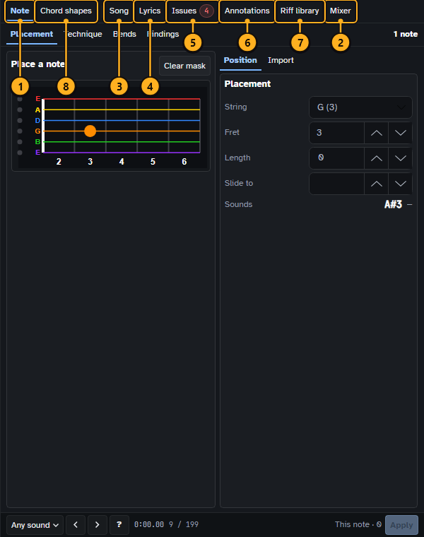

<!-- guide:callouts inspector-tabs -->
1. **Sound.** The selected note, chord or hand shape, with string, fret, length, techniques and bends.
2. **Mixer.** Volume, effects, EQ and chart sound.
3. **Song.** Key signature, and renaming tones, sections and phrases everywhere at once.
4. **Lyrics.** Paste lyrics, then tap each syllable with Ctrl+Space while the song plays.
5. **Issues.** Everything the checker found, export blockers first. Click one to jump to it.
6. **Notes.** Reminders and marks pinned to the timeline.
7. **Riff library.** Riffs you saved, ready to drop back in.
8. **Chord shapes.** Every chord shape of the arrangement, where it is used, and which lack a fingering.
<!-- /guide:callouts -->

When you select a **note**, the Sound tab shows where it is played.

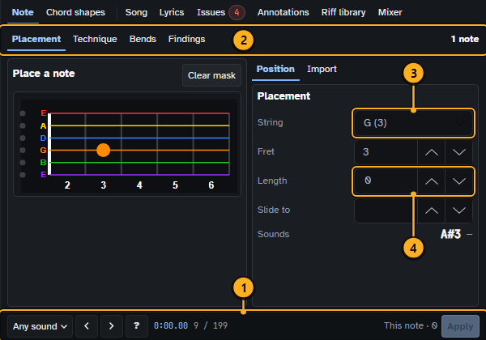

<!-- guide:callouts inspector-note -->
1. **Selection.** Which sounds the arrows step through, the arrows themselves, and the selection's position among all sounds.
2. **Sections.** Placement, Techniques, Bends and Findings. Findings shows what the checker found about this note. Click one to jump to it.
3. **String.** Moves the note to another string. Fret sets the fret below it.
4. **Length.** The sustain, in grid steps. Slide to sets where a slide ends.
<!-- /guide:callouts -->

When you select a **chord**, it shows the chord's shape.

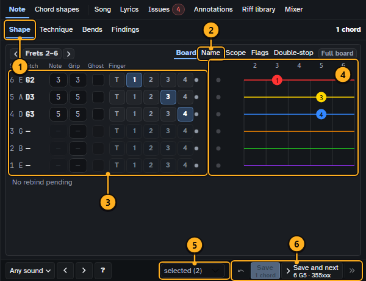

<!-- guide:callouts inspector-chord -->
1. **Shape.** The chord's frets, name and fingering.
2. **Name.** The Name page sets the chord name the player sees. Board, Scope, Flags and Double-stop are the other pages.
3. **Fingering.** One row per string, with its fret, ghost mark and the finger that holds it.
4. **Fretboard.** Click a fret to place or move the string's note.
5. **Apply to.** Applies the shape to the same chord elsewhere.
6. **Save.** Writes the shape. Save and next moves on to the next use. The arrow at the left undoes the last save.
<!-- /guide:callouts -->

### The 3D preview

The 3D preview sits right of the Inspector in the picture at the top. It shows the highway exactly as a
player will see it in Play Mode, at the playhead. Notes fly toward the fretboard on their string, and
the hand position marks where the fretting hand sits. Chord names and techniques are drawn on the
notes. Use it to check that a passage reads well. **Live play** in its header lets you play along
with your guitar inside the editor and get scored. Show or hide the preview under **View ▸ Panels ▸ 3D
preview**.

## Walkthrough: from audio to an exported chart

### 1. Import the audio

1. Choose **File ▸ New project…** Pick the song's audio file and fill in title, artist and the
   arrangement's tuning. DotCharter copies the audio into the project folder.
2. For an existing project without audio, use **File ▸ Audio ▸ Attach audio…**
3. If you already have a chart in another format, use **File ▸ Import** instead. It reads Guitar Pro,
   Editor on Fire, arrangement XML or MIDI.
4. Save with **File ▸ Save project** (Ctrl+S).

### 2. Build the beat map

Everything snaps to beats, so the beat map comes first.

1. Play the song (Space) and watch the beat lines on the timeline. If you imported a tab and its beats
   drift from the music, use **Tempo map ▸ Fit the tab's tempo to the recording…**. It matches the tab's
   notes against the audio, so the chart needs notes. On a chart without notes the row is disabled.
   Then you set the tempo by hand, as the next step describes.
2. Fix single beats with **Tempo map ▸ Insert beat at playhead** and **Remove beat at playhead**, add
   whole bars with **Insert measures at playhead…**, or set one tempo for everything with
   **Set BPM for all measures…**
3. If the song needs a lead-in, add it under **Tempo map ▸ Start & end…**.
4. When the beats are right, **Tempo map ▸ Lock beat map** so no later edit moves them.

### 3. Place notes, chords and techniques

1. Pick the arrangement to work on in the toolbar's **Arrangements** panel. Pick a **Grid snap** that
   fits the passage. 1/8 or 1/16 works for most riffs.
2. Move the playhead to where a note starts and add it on its string. Type the fret number to set it.
   The keys for this are listed under **Help ▸ Keyboard shortcuts…** and you can change them in
   **Settings ▸ Keybinds**. Turn on **Keyboard note entry** in **Settings ▸ Editor** to chart from the
   keyboard alone.
3. Select a note to edit it in the Inspector's **Sound** tab. Set string, fret, length and slide in
   **Placement**. Set hammer-ons, palm mutes, harmonics, vibrato and the rest in **Techniques**. Set
   bends in **Bends**.
4. For chords, place the notes that sound together and use **Edit ▸ Chord ▸ Merge notes into
   chord**. You can also turn a single note into a power chord. Name and finger the chord in the
   Inspector's **Shape** section. **Tools ▸ Generate** creates the hand shapes that show the chord box.
5. **Tools ▸ Generate ▸ Fret hand positions** places the hand positions. It works on the whole
   arrangement when nothing is selected, and otherwise on the selected notes. Check them in the 3D
   preview.
6. Use **Chart sound** in the toolbar to hear the charted notes against the song.

### 4. Mark sections and phrases

1. Turn on the **Sections** and **Phrases** rows under **View ▸ Rows**.
2. Add a section and a phrase where each part of the song begins. A section can be an intro, verse,
   chorus, solo and so on. The Inspector's **Song** tab renames a section or phrase everywhere at once.
3. **Tools ▸ Generate ▸ Structure (COUNT / END)** adds the COUNT and END phrases for you.
4. **Arrangements ▸ Copy sections & phrases to other arrangements** gives every path the same
   structure.
5. **Tools ▸ Generate ▸ Difficulty levels…** builds easier versions of each
   phrase, so players can start simple and level up.

### 5. Check and export

1. Open the Inspector's **Issues** tab, or choose **Tools ▸ Fix & clean up ▸ Chart quality report**,
   which opens the Issues tab. Everything that would stop the chart from exporting is listed first.
   Click a finding to jump to it, and use **Fix** where it is offered. **Tools ▸ Fix & clean up ▸ Fix
   chart…** lists the common faults it would repair, and the polish it would add, before it changes
   anything.
2. Fill in the song's details under **File ▸ Song metadata…**
3. Export under **File ▸ Export**. You can export a DotCharter song file to share or play, a Guitar
   Pro or Editor on Fire file, or sheet music as PDF.
4. In **File ▸ Export ▸ Rocksmith package…**, watch for the amber box under **Package form**. It
   appears whenever DotCharter will write the package unencrypted. Rocksmith 2014 only loads an
   unencrypted package with the RS7String 7-string mod. For a standard chart, press **Export DLC
   Builder project…** in that box. It writes the chart as a DLC Builder project (`.rs2dlc`) with
   its Rocksmith XML into a folder you pick. Open it in DLC Builder and build the package there.

## Every menu

The editor's menu bar holds every command. Commands that act on a selection are grayed out until
something is selected. Each row shows its shortcut on the right, if it has one.

### File

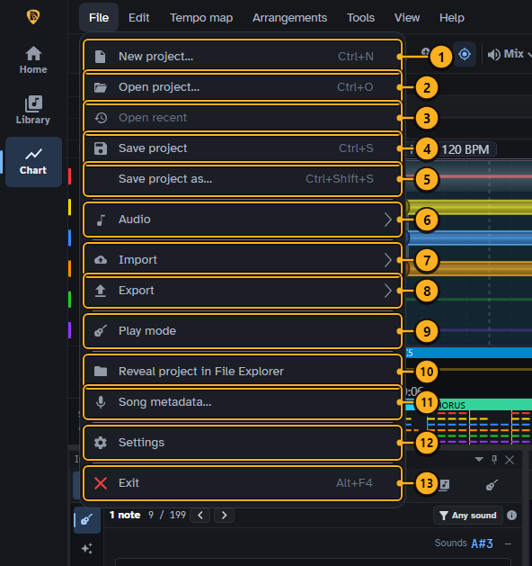

<!-- guide:callouts menu-file -->
1. **New project.** Starts a project from an audio file, with title, artist and tuning.
2. **Open project.** Opens a saved DotCharter project.
3. **Open recent.** The projects you opened last.
4. **Save project.** Saves the project (Ctrl+S).
5. **Save project as.** Saves a copy under a new name or folder.
6. **Audio.** Attaches an audio file, downloads a video's audio from YouTube, or splits the audio into stems.
7. **Import.** Brings in a chart from another format. See the Import submenu below.
8. **Export.** Writes the chart to other formats. See the Export submenu below.
9. **Play mode.** Switches to Play Mode to play the song like a game.
10. **Reveal project.** Opens the project folder in File Explorer.
11. **Song metadata.** Title, artist, album, year and the other song details.
12. **Settings.** Opens the settings.
13. **Exit.** Closes DotCharter and asks about unsaved changes first.
<!-- /guide:callouts -->

#### File ▸ Import

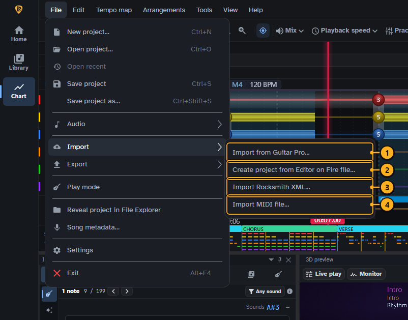

<!-- guide:callouts menu-file-import -->
1. **Guitar Pro.** Imports a Guitar Pro file as arrangements, with tempo and sections.
2. **Editor on Fire.** Creates a project from an Editor on Fire project file.
3. **Rocksmith XML.** Imports an arrangement from a Rocksmith arrangement XML file into the open project.
4. **MIDI file.** Imports notes from a MIDI file.
<!-- /guide:callouts -->

#### File ▸ Export

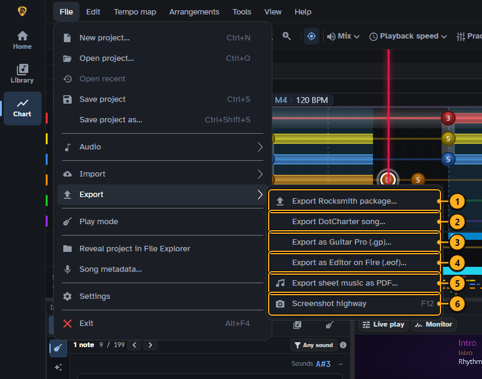

<!-- guide:callouts menu-file-export -->
1. **Rocksmith package.** Builds a custom-song package of the chart, with every arrangement, for the game.
2. **DotCharter song.** Packs the project, audio included, into one song file to share.
3. **Guitar Pro.** Writes the chart as a Guitar Pro file.
4. **Editor on Fire.** Writes an Editor on Fire project.
5. **Sheet music PDF.** Prints the chart as notation and tab to a PDF.
6. **Screenshot highway.** Saves a picture of the 3D highway (F12).
<!-- /guide:callouts -->

### Edit

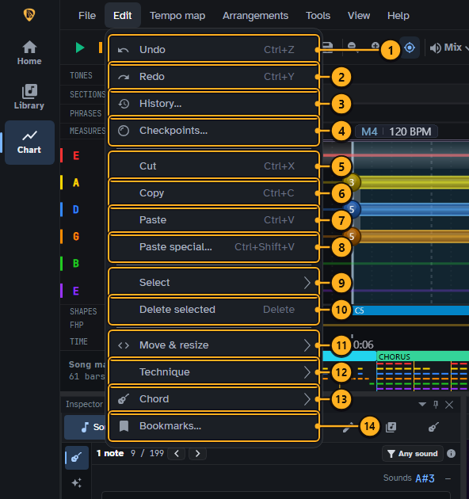

<!-- guide:callouts menu-edit -->
1. **Undo.** Takes back the last edit (Ctrl+Z).
2. **Redo.** Repeats an undone edit.
3. **History.** The list of edits. You can jump back to any of them.
4. **Checkpoints.** Named snapshots of the project you can return to.
5. **Cut.** Cuts the selection.
6. **Copy.** Copies the selection.
7. **Paste.** Pastes at the playhead.
8. **Paste special.** Chooses what to paste. Options include notes, hand shapes, positions and more.
9. **Select.** Select all, select similar, the pattern builder and your saved patterns. See below.
10. **Delete selected.** Deletes the selection.
11. **Move & resize.** Snaps notes to the grid, changes their length, doubles or halves the tempo around them and nudges them in time. See below.
12. **Technique.** Turns a technique on or off for the whole selection, such as hammer-on, harmonic or mute. See below.
13. **Chord.** Turns notes into chords and back, and switches fingerings. See below.
14. **Bookmarks.** Lists the ten bookmarks with their times. You can set one at the playhead, jump to it or clear it.
<!-- /guide:callouts -->

#### Edit ▸ Move & resize

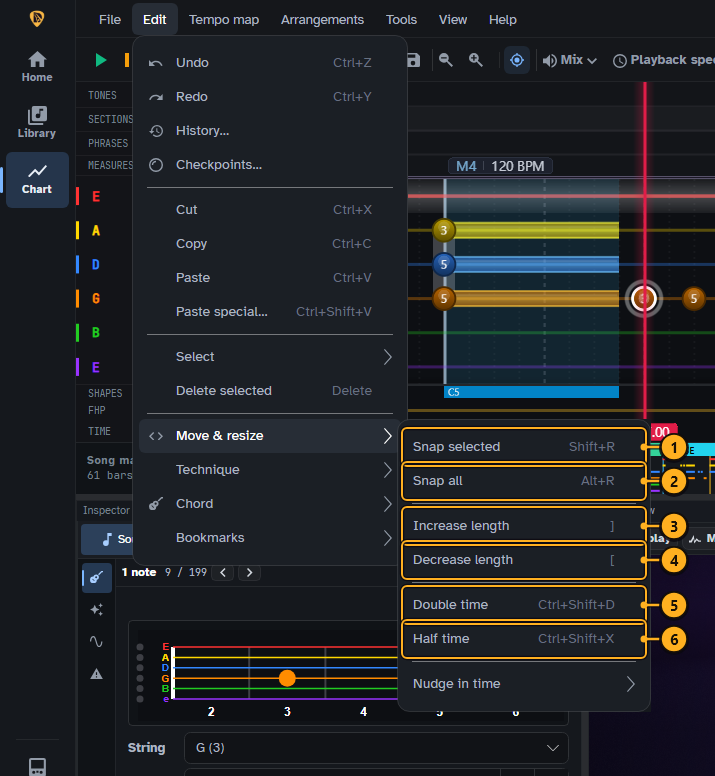

<!-- guide:callouts menu-edit-snap -->
1. **Snap selected.** Moves the selected notes onto the nearest grid line.
2. **Snap all.** Snaps every note of the arrangement.
3. **Increase length.** Makes the selected sustains one grid step longer.
4. **Decrease length.** Makes them one grid step shorter.
5. **Double time.** Doubles the tempo of the measures around the selection.
6. **Half time.** Halves it.
<!-- /guide:callouts -->

**Double time** and **Half time** double or halve the tempo of the measures around the selection. Both show their shortcuts and are enabled while something is selected. **Nudge in time** opens one more level. It moves the selection earlier or later by a grid step, 10 ms or 1 ms.

#### Edit ▸ Select

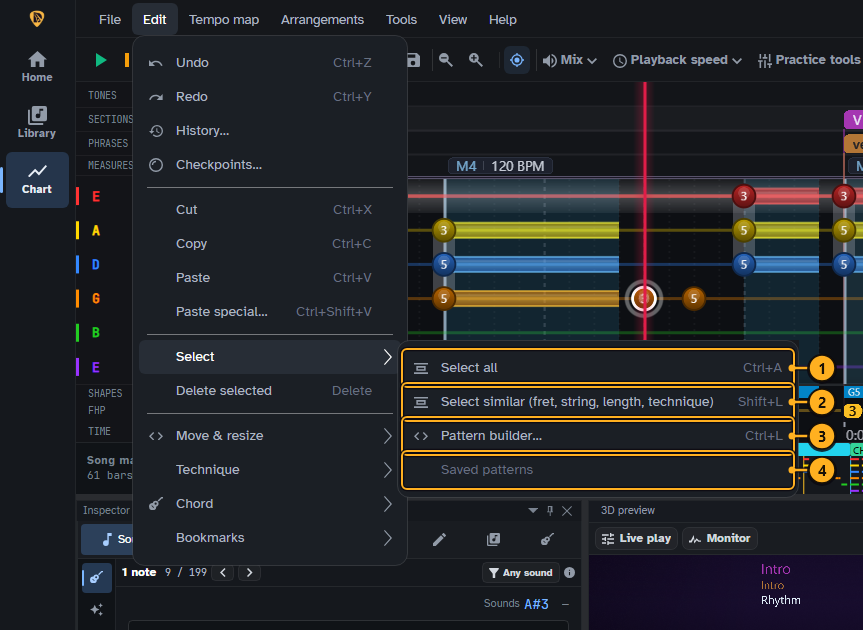

<!-- guide:callouts menu-edit-select -->
1. **Select all.** Selects every note and chord of the arrangement.
2. **Select similar.** Adds every note, chord, hand shape and anchor that plays the same thing as the selection. The status bar says how many were added.
3. **Pattern builder.** Builds a repeating pattern of notes and fills a range with it.
4. **Saved patterns.** Runs one of your saved patterns on the selection in one click.
<!-- /guide:callouts -->

Select similar and every saved pattern say what they did in the status bar. Examples are "Added 12 notes, 2 chords (14 selected)" and "Nothing similar found".

#### Edit ▸ Technique

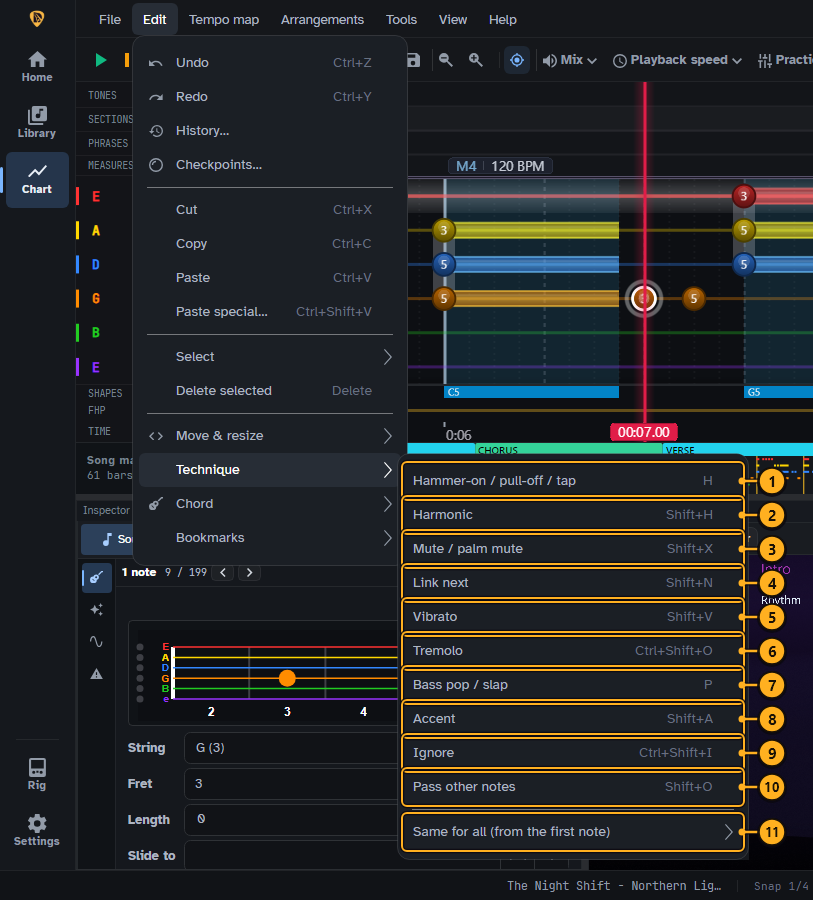

<!-- guide:callouts menu-edit-technique -->
1. **Hammer-on / pull-off / tap.** Steps each selected note through hammer-on, pull-off, tap and off.
2. **Harmonic.** Turns the harmonic on or off.
3. **Mute / palm mute.** Steps each selected note through mute, palm mute and off.
4. **Link next.** Links each selected note to the next one.
5. **Vibrato.** Turns vibrato on or off.
6. **Tremolo.** Turns tremolo picking on or off.
7. **Bass pop / slap.** Steps each selected bass note through pop, slap and off.
8. **Accent.** Turns the accent on or off.
9. **Ignore.** Turns the ignore flag on or off.
10. **Pass other notes.** Turns the pass-other-notes flag on or off.
11. **Same for all.** Works out the next value from the first selected note and gives it to every selected note.
<!-- /guide:callouts -->

Each row shows its shortcut and is enabled while something is selected. A row reports what it did in the status bar, for example "Hammer-on set on 9 items". Hammer-on, mute and bass pop / slap step through their kinds. A second press moves on to the next kind.

#### Edit ▸ Chord

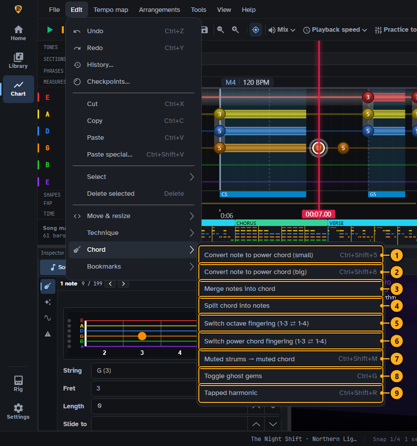

<!-- guide:callouts menu-edit-chord -->
1. **Power chord (small).** Turns a note into a two-string power chord.
2. **Power chord (big).** Turns a note into a three-string power chord.
3. **Merge into chord.** Joins notes at the same time into one chord.
4. **Split into notes.** Breaks a chord into single notes.
5. **Octave fingering.** Switches octave shapes between fingers 1-3 and 1-4.
6. **Power chord fingering.** Switches power chords between fingers 1-3 and 1-4.
7. **Muted strums.** Turns muted strums into a muted chord.
8. **Ghost gems.** Marks notes as held in the chord box but not played.
9. **Tapped harmonic.** Makes the selected notes tapped harmonics.
<!-- /guide:callouts -->

**Edit ▸ Bookmarks…** lists the ten bookmarks, 0 to 9, with the time each holds. Go to jumps to a bookmark, Set here puts it at the playhead, and Clear empties it. The digit keys can still set, jump to and clear one in a single press.

### Tempo map

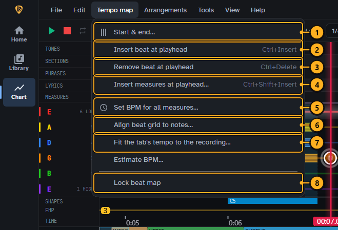

<!-- guide:callouts menu-tempo-map -->
1. **Start & end.** Opens one dialog for adding silence or measures before the first or after the last beat, or for the default start silence.
2. **Insert beat.** Adds a beat at the playhead. Only that measure grows, and its time signature says so (4/4 becomes 5/4); every other bar line stays.
3. **Remove beat.** Removes the beat at the playhead. Only that measure shrinks (4/4 becomes 3/4); every other bar line stays.
4. **Insert measures.** Inserts whole measures before the measure at the playhead. The dialog picks their time signature and tempo; both start as that measure's.
5. **Set BPM.** Sets one tempo for every measure.
6. **Align beat grid.** Moves the beat grid so it lines up with the charted notes.
7. **Fit tempo to recording.** Moves the beats of an imported tab onto the recording by matching its notes to the audio. Disabled while the chart has no notes.
8. **Lock beat map.** Protects the beats from being moved by accident.
<!-- /guide:callouts -->

### Arrangements

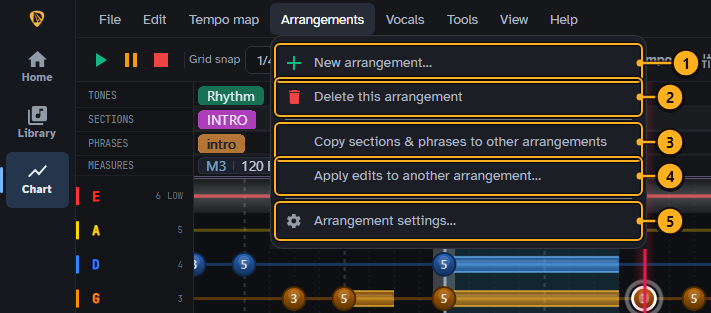

<!-- guide:callouts menu-arrangements -->
1. **New arrangement.** Adds a lead, rhythm, bass or other path to the song.
2. **Delete arrangement.** Removes the active arrangement.
3. **Copy sections & phrases.** Copies this arrangement's section and phrase markers to every other one.
4. **Copy edits to another arrangement.** Copies hand positions, fingerings and hand shapes where two arrangements play the same notes.
5. **Arrangement settings.** Name, type, tuning, capo and string count.
<!-- /guide:callouts -->

### Vocals

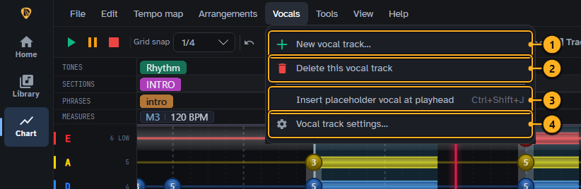

<!-- guide:callouts menu-vocals -->
1. **New vocal track.** Adds a lyrics track.
2. **Delete vocal track.** Removes the active vocal track.
3. **Insert vocal.** Adds a placeholder syllable at the playhead.
4. **Vocal track settings.** Name and options of the vocal track.
<!-- /guide:callouts -->

### Tools

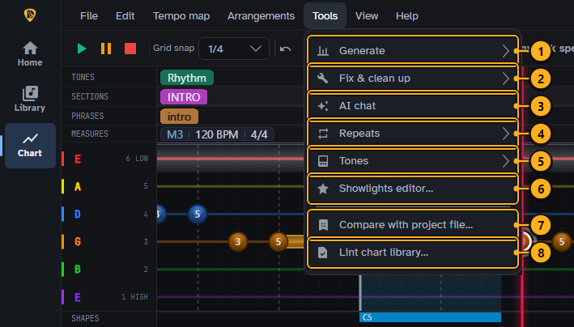

<!-- guide:callouts menu-tools -->
1. **Generate.** Lets the app write hand positions, hand shapes, the COUNT and END phrases and difficulty levels. See below.
2. **Fix & clean up.** The quality report first, then the tools that repair and polish a chart. See below.
3. **AI chat.** Opens the AI chat panel. You can ask for fingering, hand positions, chord names, sections or tones, or ask a question about the chart. See below.
4. **Repeats.** Keeps parts that come back the same. It copies a phrase to its repeats and links identical measures. See below.
5. **Tones.** Tone designer, rig and tuner.
6. **Showlights editor.** Edits the stage lights that play with the song in the 3D view.
7. **Compare with the saved version.** Shows what differs between the open chart and a saved one.
8. **Check every chart in the library.** Checks every project in a folder and can fix them.
<!-- /guide:callouts -->

#### Tools ▸ Generate

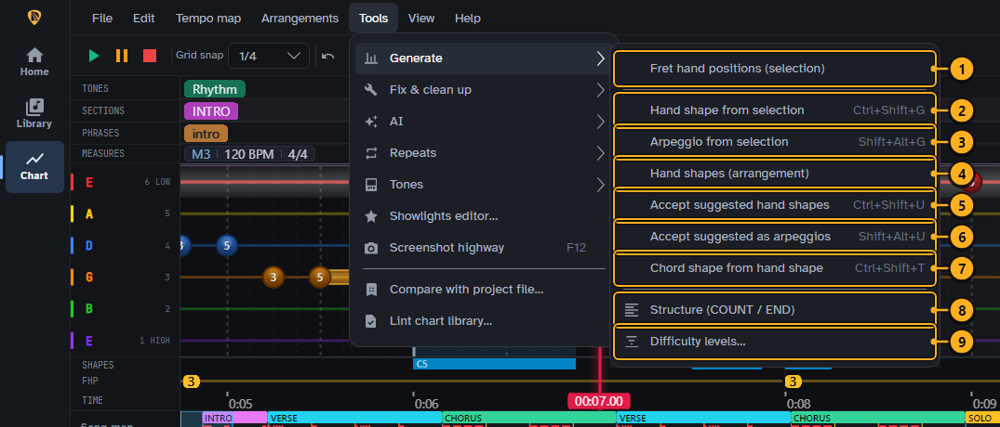

<!-- guide:callouts menu-tools-generate -->
1. **Fret hand positions.** Places the hand positions for the selected notes, or for the whole arrangement when nothing is selected. The row says which.
2. **Hand shape from selection.** Makes a chord hand shape over the selected notes.
3. **Arpeggio from selection.** Makes an arpeggio hand shape over the selected notes.
4. **Hand shapes (arrangement).** Generates hand shapes for every chord.
5. **Accept suggestions.** Turns the dashed suggested shapes in the selection into real ones.
6. **Accept as arpeggios.** The same, as arpeggio shapes.
7. **Chord shape from hand shape.** Gives the selected chords the chord shape of the hand shape over them.
8. **Structure.** Adds the COUNT and END phrases and no-guitar sections over silences.
9. **Difficulty levels.** Builds easier difficulty levels from the hardest one.
<!-- /guide:callouts -->

The first row is one command for both scopes. With notes or chords selected, it reads **Fret hand positions (selection)** and works on them. Otherwise it reads **Fret hand positions (arrangement)**.

#### Tools ▸ Fix & clean up

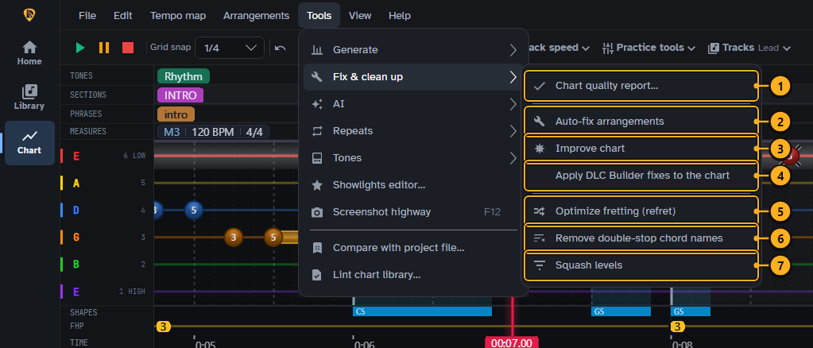

<!-- guide:callouts menu-tools-fix -->
1. **Chart quality report.** Every check in one list, with Go to and Fix for each finding. Look here first.
2. **Fix chart.** Lists what would change before anything does. Errors are order, duplicates, lengths, slides and anchors. Polish is trim to the audio, END phrase and hand positions. It is one undo step.
3. **Apply DLC Builder fixes.** Puts DLC Builder's fixes and difficulty levels into the project, as a Rocksmith export does to its copy.
4. **Optimize fretting.** Moves notes to other strings to reduce hand movement.
5. **Remove double-stop names.** Clears chord names from two-string shapes.
6. **Merge all difficulty levels into one.** Merges the difficulty levels back into one.
<!-- /guide:callouts -->

**Apply DLC Builder fixes** replaces the arrangement's levels, chord templates and phrases with the ones DLC Builder builds, so DotCharter never runs it for you. It is also on a right-click of the empty highway.

#### Tools ▸ AI chat

The AI fix rows are tasks of the AI chat panel. They are fingering only, hand positions and fingering, hand positions only, and chord names in the EOF or the musical style. Pick one in the panel's task list and press Send. With an empty box it runs as the old row did, and typing words steers it. The command palette still lists each old row and starts its task in the panel. Every task needs a provider set up in **Settings ▸ AI**. The panel's own AI settings button opens it. The tasks work on the scope the panel names, which is the selection, a section or the whole arrangement. They hold their proposals in a review card for you to accept.

#### Tools ▸ Repeats

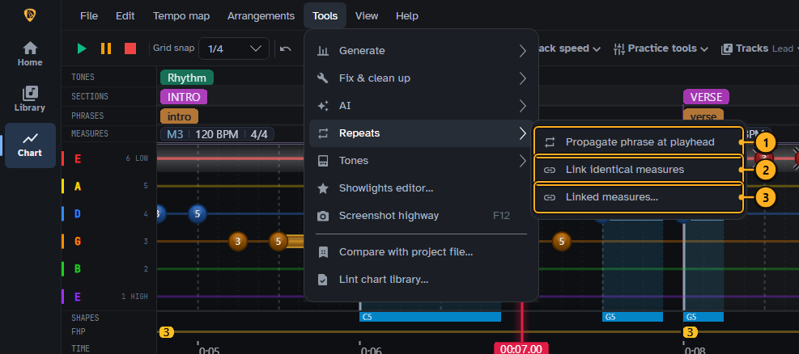

<!-- guide:callouts menu-tools-repeats -->
1. **Copy this phrase to its repeats.** Copies the phrase under the playhead to every repeat of it.
2. **Link identical measures.** Links the selected measures with every other run that plays the same, so an edit reaches all of them.
3. **Linked measures.** Lists the song's link groups. You can rename one, unlink it or go to a placement.
<!-- /guide:callouts -->

#### Tools ▸ Tones

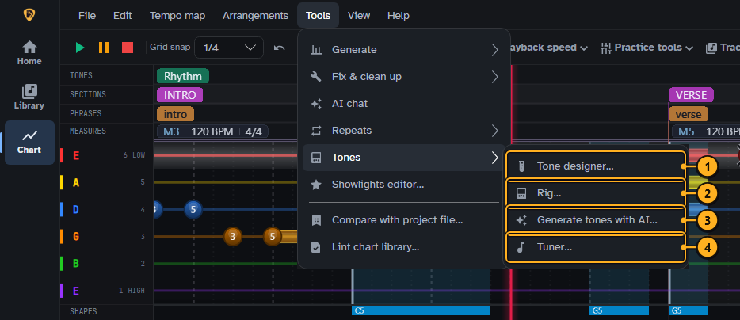

<!-- guide:callouts menu-tools-tone -->
1. **Tone designer.** Edits the tones the song switches between.
2. **Rig.** Opens the tone rig.
3. **Generate tones with AI.** Asks your AI provider for one tone per tone change.
4. **Tuner.** Tunes your instrument to the arrangement's tuning.
<!-- /guide:callouts -->

### View

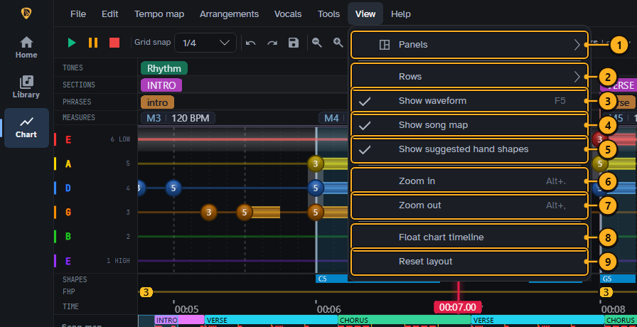

<!-- guide:callouts menu-view -->
1. **Panels.** Shows or hides the editor's panels. See below.
2. **Rows.** Shows or hides the rows above the strings. See below.
3. **Show waveform.** Draws the audio waveform behind the notes.
4. **Show song map.** The overview strip of the whole song under the timeline.
5. **Suggested hand shapes.** Shows dashed hand-shape suggestions.
6. **Zoom in.** Stretches the timeline.
7. **Zoom out.** Shows more of the song.
8. **Float chart timeline.** Moves the timeline into its own window.
9. **Reset layout.** Puts every panel back where it started.
<!-- /guide:callouts -->

#### View ▸ Panels

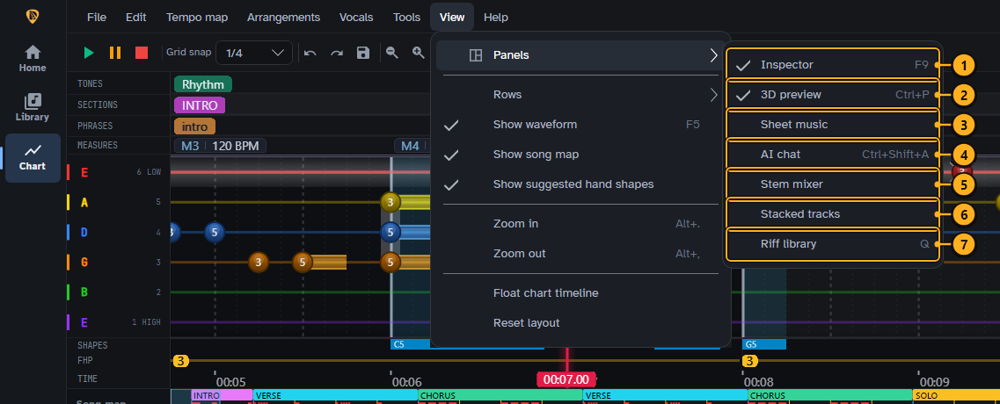

<!-- guide:callouts menu-view-panels -->
1. **Inspector.** Properties of the selection.
2. **3D preview.** The highway as a player sees it.
3. **Sheet music.** Notation and tab under the timeline.
4. **AI chat.** Ask an AI assistant about fingering, hand positions and sections.
5. **Mixer.** Levels of the separated stems.
6. **Other arrangements: show stacked.** The other arrangements, stacked under this one.
7. **Riff library.** Saved riffs to drop back into a chart.
<!-- /guide:callouts -->

#### View ▸ Rows

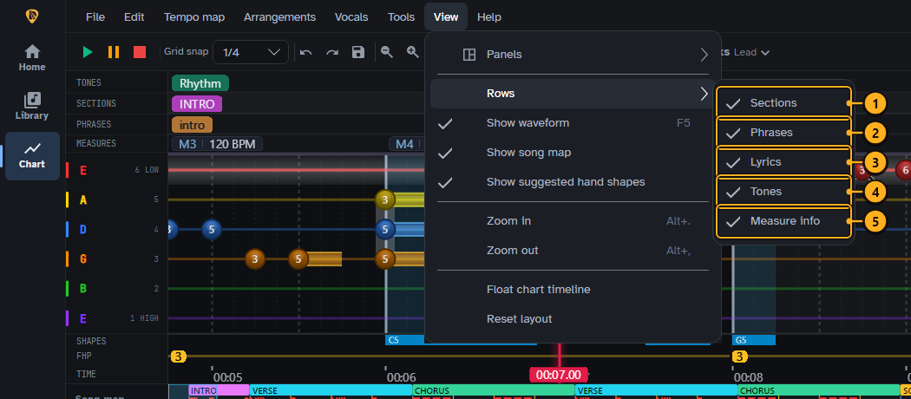

<!-- guide:callouts menu-view-rows -->
1. **Sections.** The section row, for intro, verse, chorus and so on.
2. **Phrases.** The phrase row.
3. **Lyrics.** The lyrics row.
4. **Tones.** The tone-change row.
5. **Measure info.** Measure numbers, tempo and time signature.
<!-- /guide:callouts -->

### Help

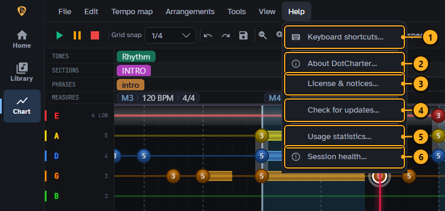

<!-- guide:callouts menu-help -->
1. **Keyboard shortcuts.** Every shortcut, searchable.
2. **About.** Version and credits.
3. **License & notices.** The license and third-party notices.
4. **Check for updates.** Looks for a newer release.
5. **Usage statistics.** Writes a local report of the commands you use. Nothing is uploaded.
6. **Diagnostics.** Rendering and audio diagnostics, and a bundle to attach to a bug report.
<!-- /guide:callouts -->

Next: [Playing a song](playing.md).
