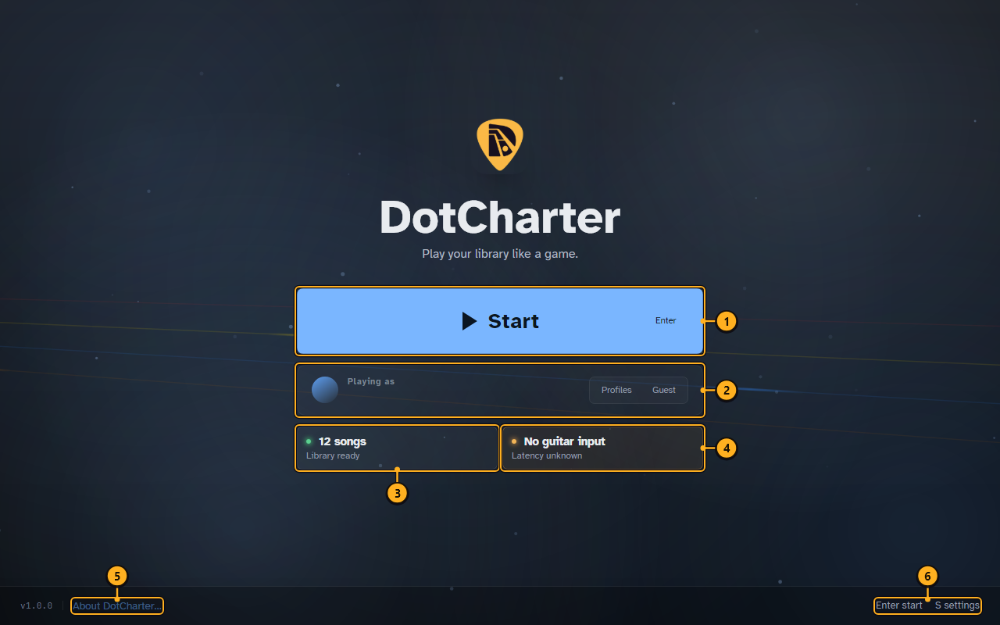
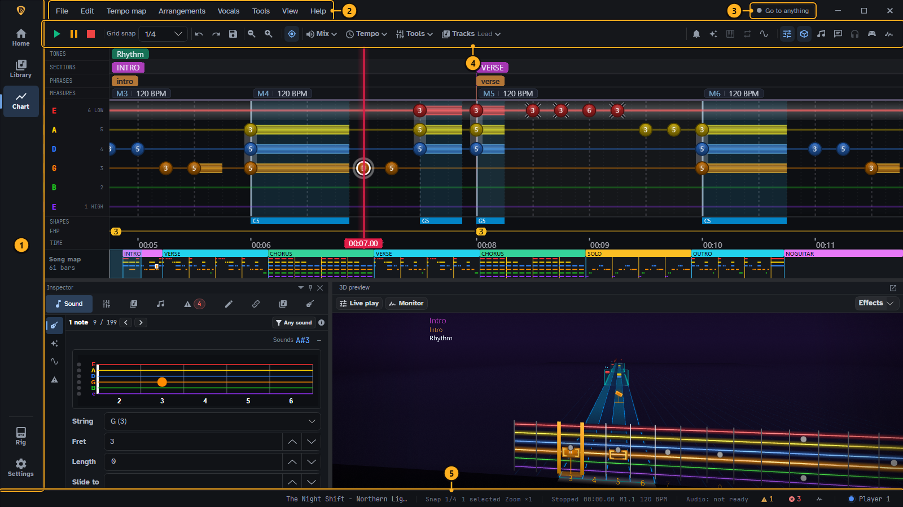
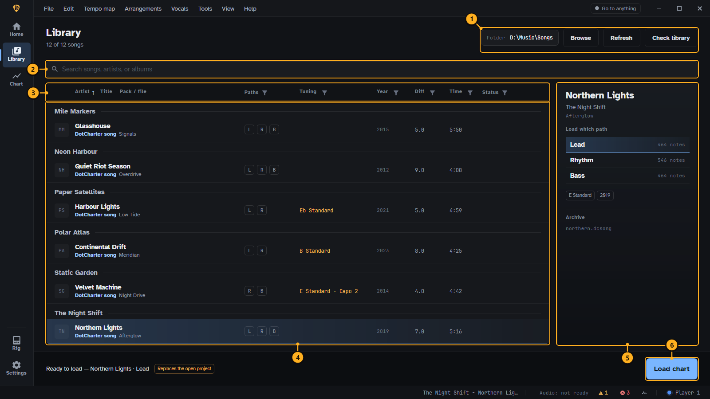

# Getting started

DotCharter has two halves. In the **editor** you chart a song: you place every note, chord and
technique on a timeline that follows the audio. In **Play Mode** you play a charted song on your
real guitar or bass, and DotCharter listens and scores you. The **rig** gives your instrument its
sound in both.

## The start screen

Play Mode opens here.

<!-- guide:callouts start-screen -->
1. **Start.** Opens the song library of Play Mode. Enter does the same.
2. **Playing as.** The profile your scores and settings are saved under. Switch or add profiles here, or play as a guest.
3. **Library status.** How many songs DotCharter found in your library folder.
4. **Guitar input.** Whether an instrument input is set up and its latency is known. Play Mode needs it to score you.
5. **About.** Version, licence and credits.
6. **Keys.** Keyboard shortcuts for this screen.
<!-- /guide:callouts -->

### First launch

1. Pick or create a profile under **Playing as**. Scores, practice history and Play Mode settings
   are kept per profile.
2. Open **Settings ▸ Audio**. Choose the output device, then turn on **Live input** and choose the
   device and channel your instrument is plugged into. See the [Settings reference](settings.md).
3. Set your library folder in the **Library** (below). DotCharter scans it for songs.

## The app's layout

<!-- guide:callouts shell-overview -->
1. **Navigation rail.** The app's destinations: Home (recent projects and what to do next), Library (your songs), Chart (the editor), Rig (your tone) and Settings.
2. **Menu bar.** All editor commands, grouped by menu. Each menu is shown in Charting a song.
3. **Go to anything.** A command palette: type part of a command, setting or song and press Enter.
4. **Toolbar.** Transport, grid snap, undo, zoom and the most used tools.
5. **Status bar.** Messages, running tasks, the playhead position and the chart's issue count.
<!-- /guide:callouts -->

## The Library

The Library lists every song in your library folder. Pick a song, then a path, and load it into the
editor or play it.

<!-- guide:callouts library -->
1. **Library folder.** The folder DotCharter scans for songs. Browse picks another one, Refresh scans again.
2. **Search.** Filters by title, artist or album as you type.
3. **Columns.** Click a column to sort by it; the funnel icons filter by paths, tuning, year, difficulty and length.
4. **Songs.** Grouped by artist. The letters L, R and B show which paths (lead, rhythm, bass) a song has.
5. **Song details.** The selected song, with each path and its note count. Pick the path to load.
6. **Load chart.** Opens the chosen path in the editor. It replaces the open project, so save first.
<!-- /guide:callouts -->

Next: [Charting a song](charting.md) or [Playing a song](playing.md).
