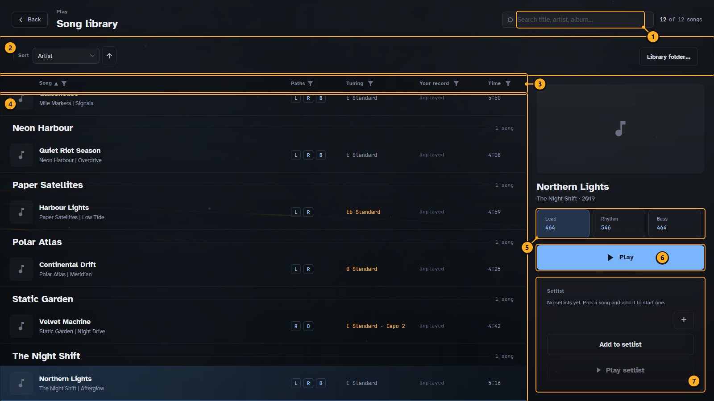
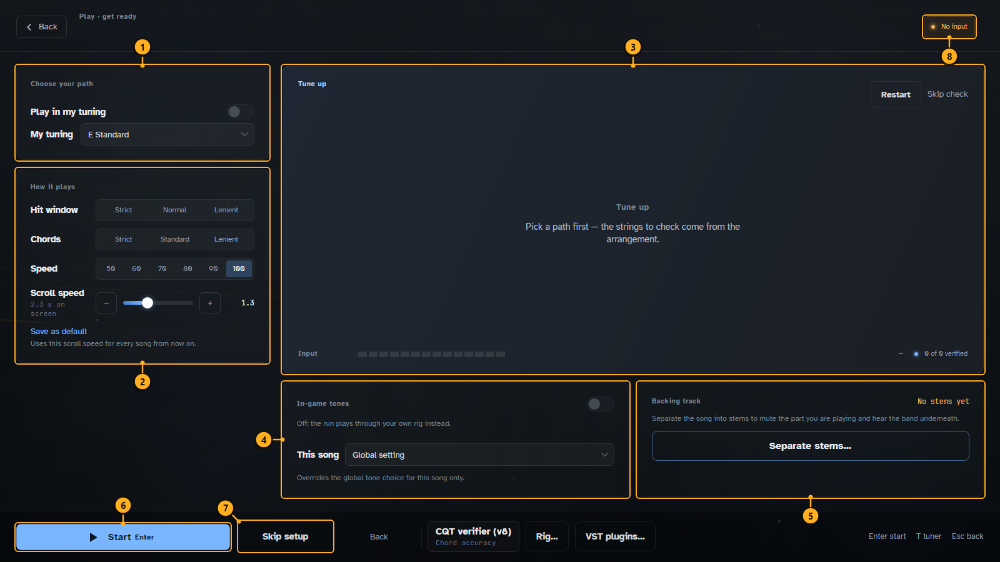
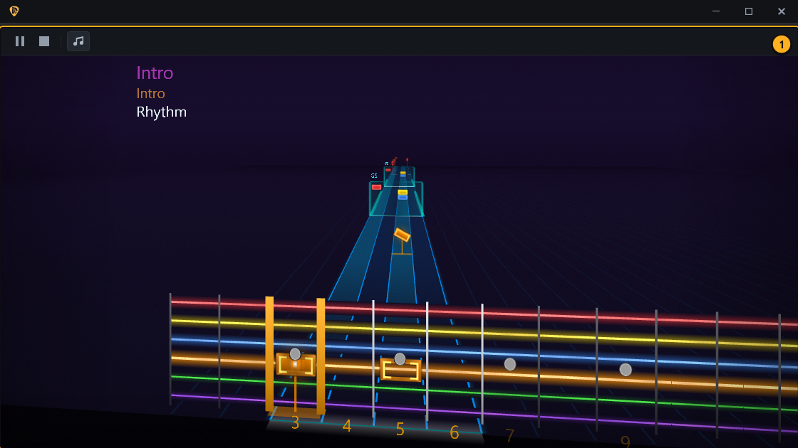
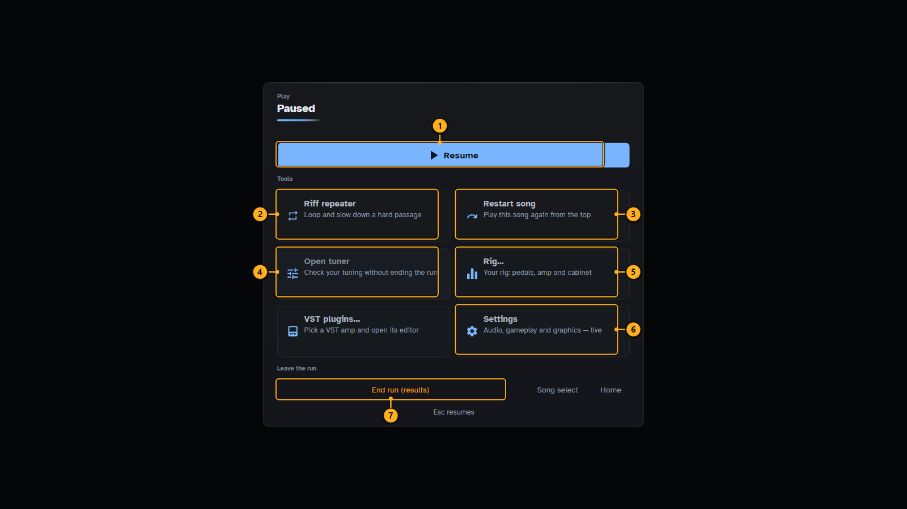
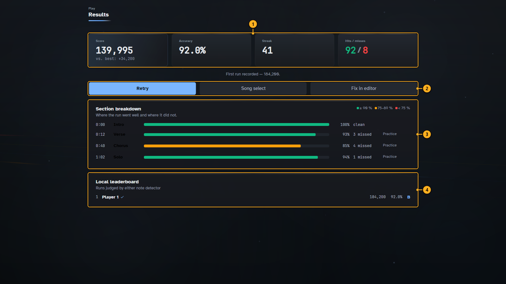
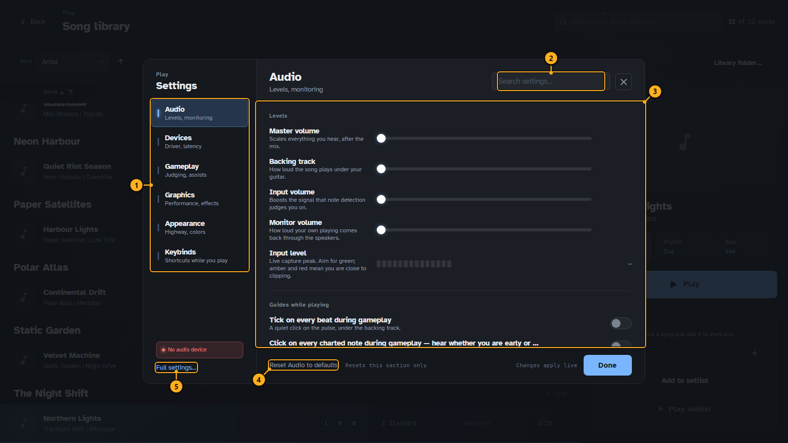

# Playing a song

In Play Mode you play a charted song on your instrument. The notes come towards you on a 3D highway;
DotCharter listens to your guitar or bass through the audio input and scores every note you hit.

Before your first run, set up your instrument input under **Settings ▸ Audio** (see the
[Settings reference](settings.md)). Without an input you can still watch a song play, but nothing is
scored.

## Walkthrough: play a song

1. On the start screen, press **Start** (or Enter). See [Getting started](getting-started.md).
2. In **Song select**, find the song, pick the path you want to play and press **Play**.
3. On **Get ready**, tune up, choose how strict the judging is and the speed, then press **Start**.
4. Play along. Press Esc to pause.
5. At the end, **Results** shows your score. Retry, pick another song, or fix the chart in the editor.

## Song select

<!-- guide:callouts play-song-select -->
1. **Search.** Finds songs by title, artist or album.
2. **Sort.** Sorts the list by artist, title, tuning and more.
3. **Columns.** Paths, tuning, your best result and length. The funnels filter.
4. **Songs.** Your library, grouped by artist.
5. **Path.** Lead, rhythm or bass, with its note count.
6. **Play.** Goes to Get ready for the selected song and path.
7. **Setlist.** Queue several songs and play them in a row.
<!-- /guide:callouts -->

## Get ready

The last screen before the song starts.

<!-- guide:callouts play-get-ready -->
1. **Your tuning.** Play in your own tuning instead of the song's.
2. **How it plays.** How strict the timing and chord judging is, the playback speed and how fast the notes scroll.
3. **Tune up.** Checks each string of your instrument before you start.
4. **In-game tones.** Plays the song's own tones, or your rig instead.
5. **Backing track.** Separate the song into stems to mute the part you play.
6. **Start.** Starts the run (Enter).
7. **Skip setup.** Starts without the tuning check.
8. **Input.** Whether your guitar signal arrives.
<!-- /guide:callouts -->

Slow a hard song down with **Speed** and build it back up as you learn it. **Strict**, **Normal** and
**Lenient** change how close to the beat a note has to be to count, and how many strings of a chord
you have to hit.

## Playing

<!-- guide:callouts play-playing -->
1. **Highway.** Notes come towards you on their string. Play them as they reach the fretboard.
<!-- /guide:callouts -->

Each lane is one string, coloured as in the editor. The number on a note is its fret; the highlighted
zone on the fretboard is where your fretting hand should be, and it moves before the hand has to.
Chords show their name and a chord box. A count-in before the first note is set under **Settings ▸
Play**.

## Pause

<!-- guide:callouts play-paused -->
1. **Resume.** Back to the song (Esc).
2. **Riff repeater.** Loops a hard passage, slowed down, until you have it.
3. **Restart song.** Plays the song again from the top.
4. **Tuner.** Checks your tuning without ending the run.
5. **Rig.** Your pedals, amp and cabinet.
6. **Settings.** Audio, gameplay and graphics, applied live.
7. **End run.** Stops and shows the results.
<!-- /guide:callouts -->

## Results

<!-- guide:callouts play-results -->
1. **Score.** Score, accuracy, longest streak, and hits against misses.
2. **Next.** Play again, pick another song, or open the song in the editor to fix it.
3. **Sections.** How each section went, coloured by accuracy.
4. **Leaderboard.** Your best runs of this song on this computer.
<!-- /guide:callouts -->

## Settings while playing

**Settings** in the pause menu opens Play Mode's own settings over the screen you are on.

<!-- guide:callouts play-settings -->
1. **Sections.** Audio, devices, gameplay, graphics, appearance and keys.
2. **Search.** Finds a setting by name.
3. **Settings.** The chosen section. Changes apply at once.
4. **Reset.** Puts this section back to its defaults.
5. **Full settings.** Every setting, in the main Settings.
<!-- /guide:callouts -->

Next: [Tone rig](tone-rig.md).
