# Settings reference

Open Settings from the **Settings** row of the navigation rail or from **File ▸ Settings**. Pages are
grouped into Workspace, System and Configuration. Changes take effect when you press **Save
changes**; **Reset section** puts the current page back to its defaults. The search box finds any
setting on any page.

Play Mode has a smaller settings panel of its own, applied live while you play; see
[Playing a song](playing.md#settings-while-playing).

## General

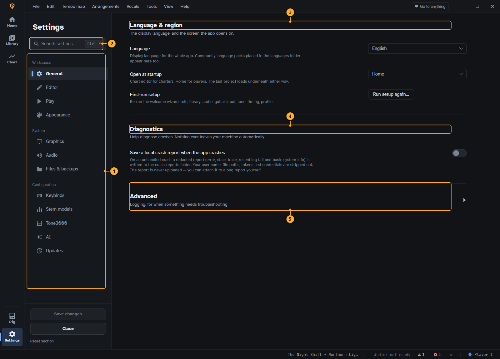

<!-- guide:callouts settings-general -->
1. **Sections.** The settings pages, in three groups.
2. **Search.** Finds any setting on any page (Ctrl+F).
3. **Language & region.** Display language and the screen DotCharter opens at.
4. **Diagnostics.** Local crash reports. Nothing leaves your computer.
5. **Advanced.** Logging options.
<!-- /guide:callouts -->

## Editor

How the chart editor behaves while you edit, how the 2D timeline looks (string order, lane tint and
polish) and the defaults of a new project.

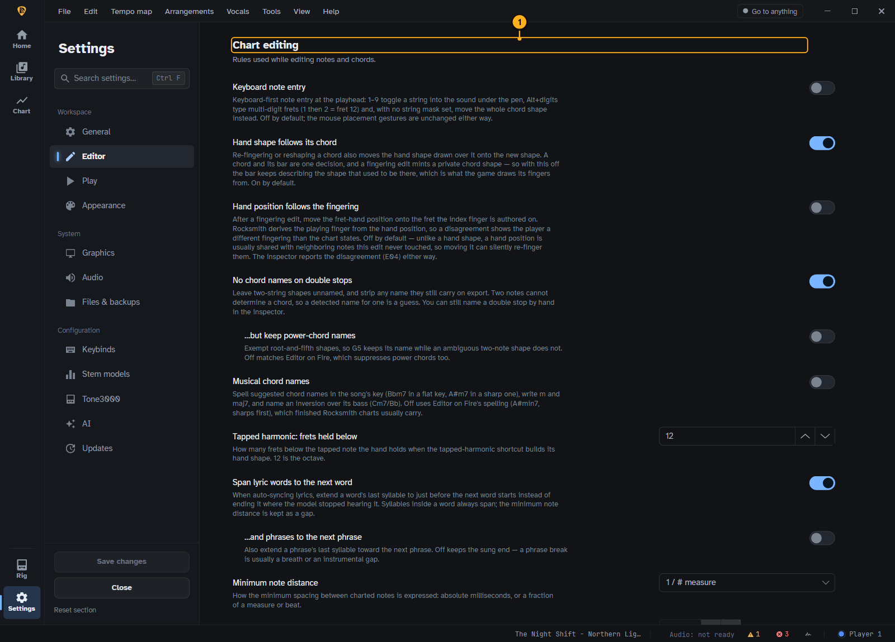

<!-- guide:callouts settings-editor -->
1. **Chart editing.** Keyboard note entry, how hand shapes and positions follow edits, chord naming.
<!-- /guide:callouts -->

Further down: **Copy & paste** (what a normal paste brings along), **New project** (default charter
name and silence padding) and **Guitar Pro import**.

## Play

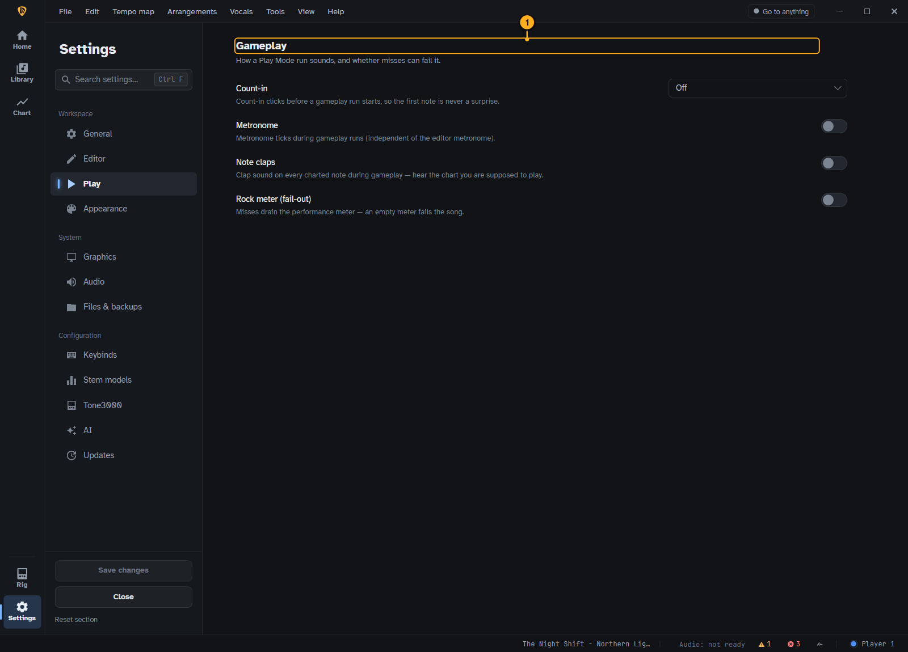

<!-- guide:callouts settings-play -->
1. **Gameplay.** Count-in, metronome, note claps and the rock meter in Play Mode.
<!-- /guide:callouts -->

## Appearance

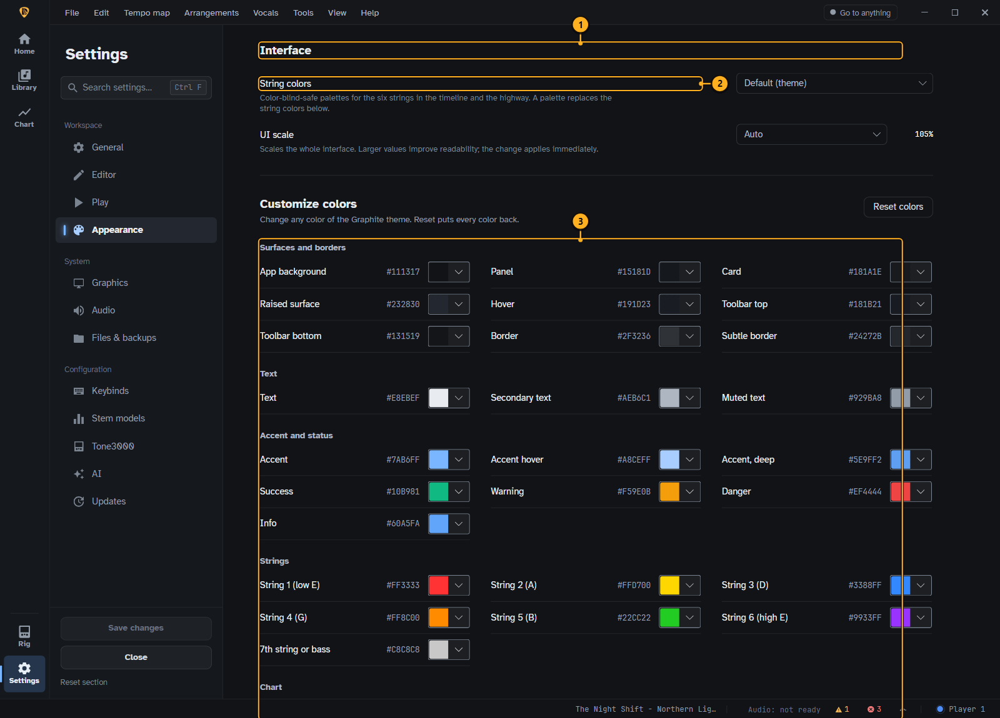

<!-- guide:callouts settings-appearance -->
1. **Interface.** String colours and the size of the whole interface.
2. **String colors.** Colour-blind-safe palettes for the strings, in the timeline and on the highway.
3. **Customize colors.** Change any colour of the theme.
<!-- /guide:callouts -->

## Graphics

The 3D highway and the editor's timeline.

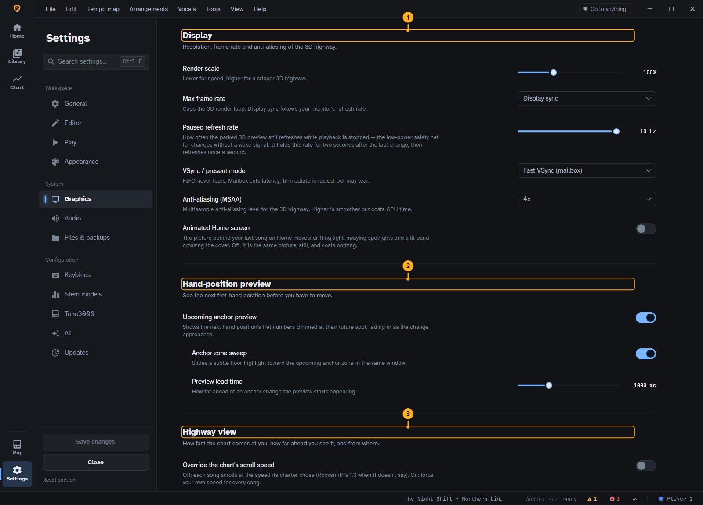

<!-- guide:callouts settings-graphics -->
1. **Display.** Render scale, frame rate, VSync and anti-aliasing.
2. **Hand-position preview.** Shows the next hand position before you need it.
3. **Highway view.** Scroll speed, draw distance and camera.
<!-- /guide:callouts -->

Further down: **Timing** (visual lead, to line the picture up with the sound),
**Highway** effects, **Showlights** and the **Stage background**.

## Audio

Where the sound goes and where your instrument comes in. Set this up before you play.

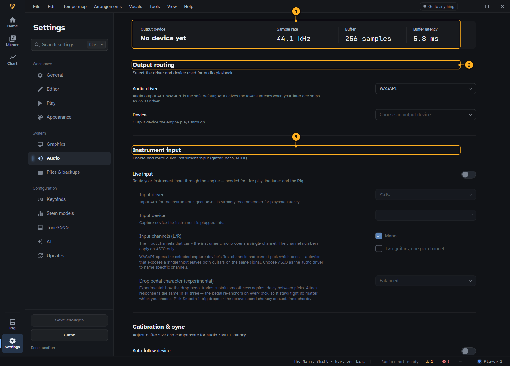

<!-- guide:callouts settings-audio -->
1. **Device summary.** The output device, sample rate, buffer and latency in use.
2. **Output routing.** The driver and device the song plays through.
3. **Instrument input.** Turn on live input and choose the device and channels your guitar is on.
<!-- /guide:callouts -->

Further down: **Calibration & sync** (sample rate, buffer size, audio delay and the latency
calibration), a **Streaming mirror** that copies the mix to a second device, and **MIDI output**.

ASIO gives the lowest latency when your audio interface has an ASIO driver; WASAPI works with every
device.

## Import & export

How Guitar Pro files and song packages are read, what a save writes next to the project, and backups.

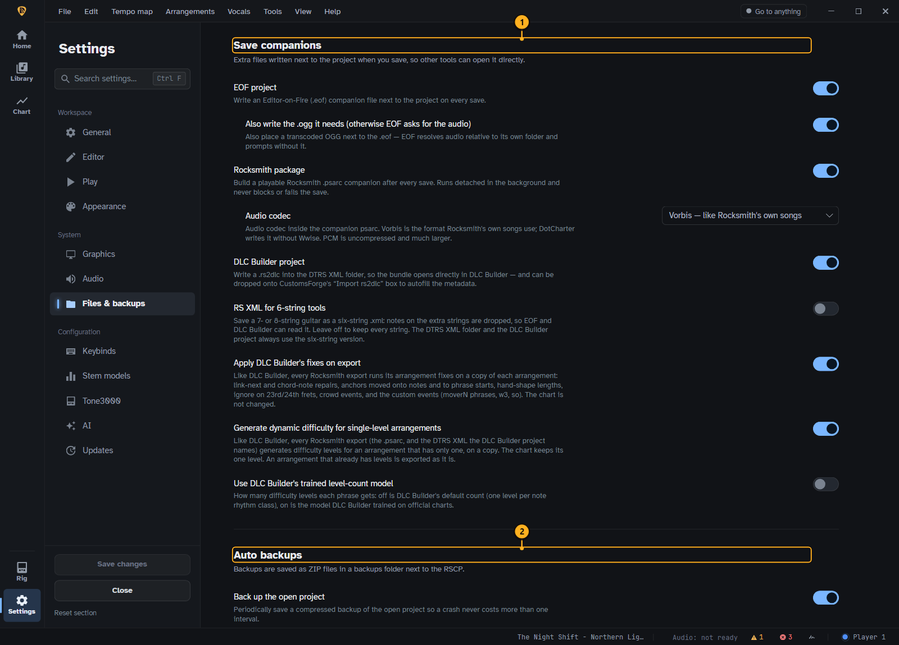

<!-- guide:callouts settings-files -->
1. **Save companions.** Extra files written next to the project on every save.
2. **Auto backups.** Timed ZIP backups of the open project.
<!-- /guide:callouts -->

## Keybinds

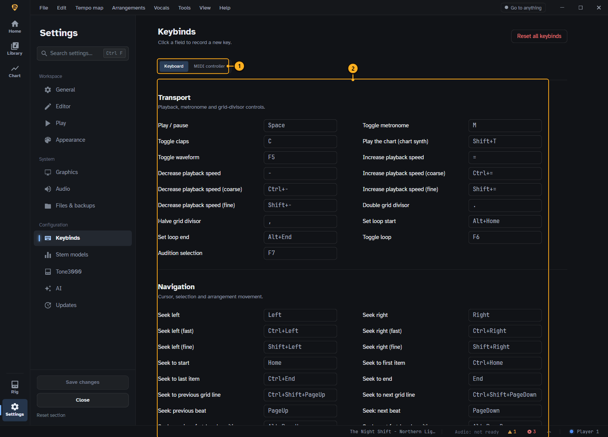

<!-- guide:callouts settings-keybinds -->
1. **Keyboard or MIDI.** Bind commands to keys, or to a MIDI controller.
2. **Bindings.** Every command and its key. Click a field and press the new key.
<!-- /guide:callouts -->

## AI & models: stem separation

Stem separation splits a song's audio into instruments, so Play Mode can mute the part you play.
Separated stems are kept, so a song is separated only once.

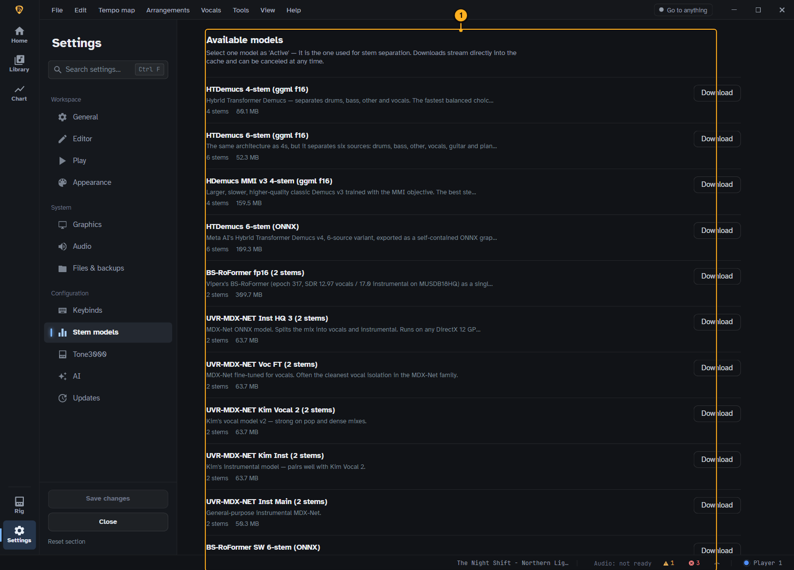

<!-- guide:callouts settings-stem-models -->
1. **Models.** The stem-separation models; pick the active one.
<!-- /guide:callouts -->

Further down: **GPU acceleration**, the **Stem cache** and adding a custom model. Stem separation is a
section of the **AI & models** page, under the provider and match-model cards.

Below it, **Lyric models** lists the models that transcribe and align lyrics: download or repair each
one, and see whether it last ran on the GPU or fell back to the CPU (with a button to try the GPU
again).

## Tone3000

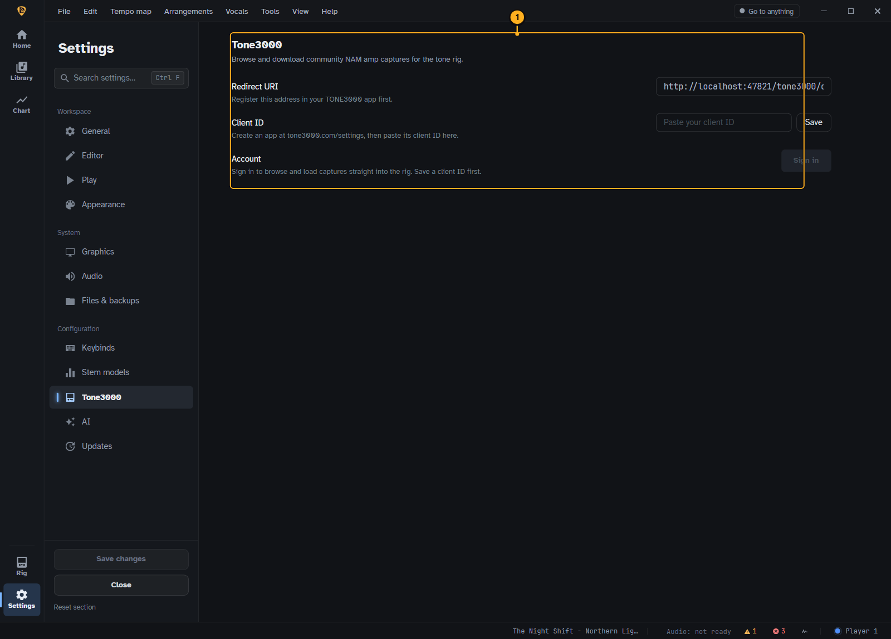

<!-- guide:callouts settings-tone3000 -->
1. **Tone3000.** Sign in to browse and download community amp captures.
<!-- /guide:callouts -->

## AI & models

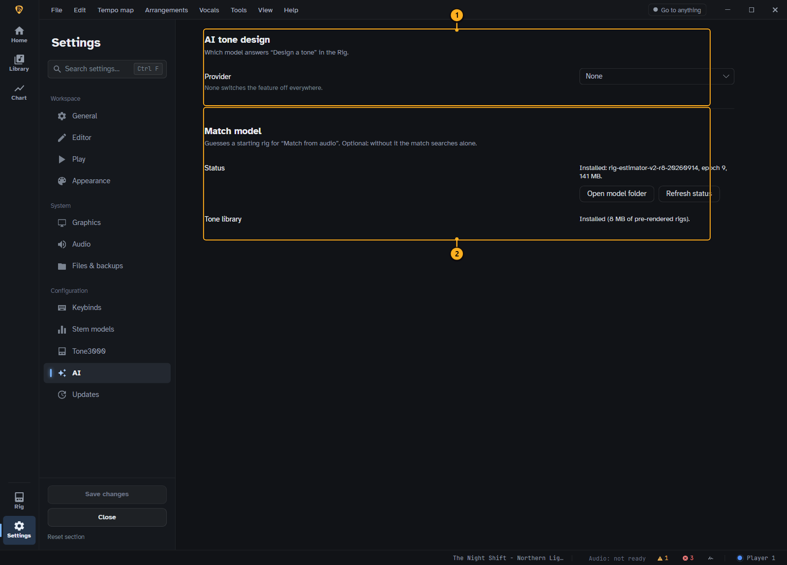

<!-- guide:callouts settings-ai -->
1. **Provider.** Which AI answers tone, chart and chat requests, and its model.
2. **Match model.** A local model that guesses a starting rig from a recording.
<!-- /guide:callouts -->

## Updates

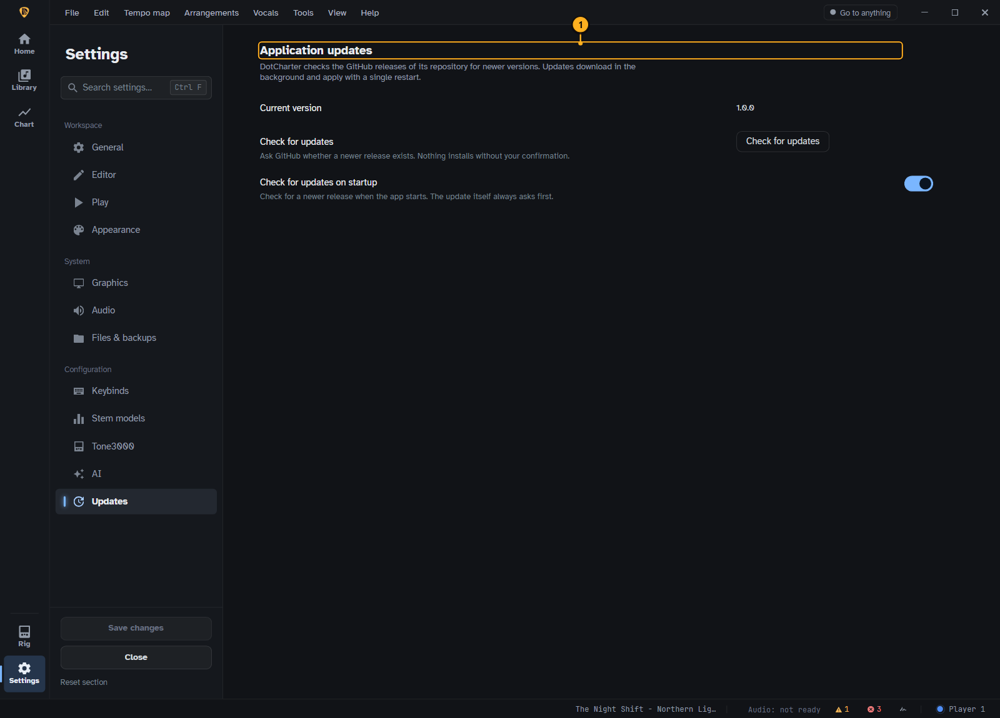

<!-- guide:callouts settings-updates -->
1. **Application updates.** Your version, and checking for a newer one.
<!-- /guide:callouts -->
