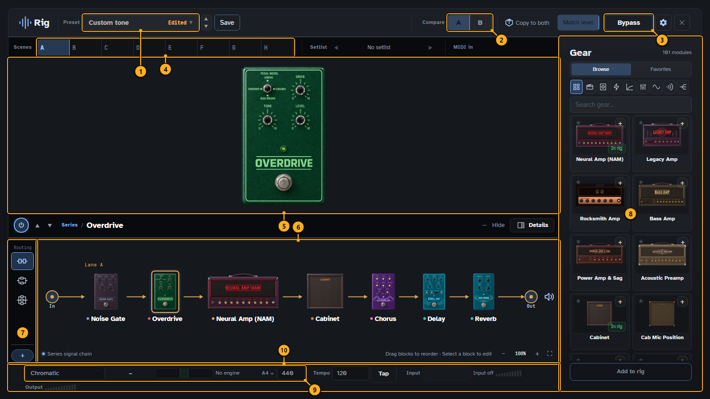
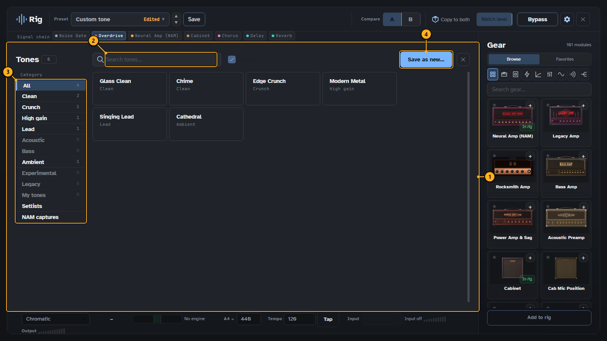
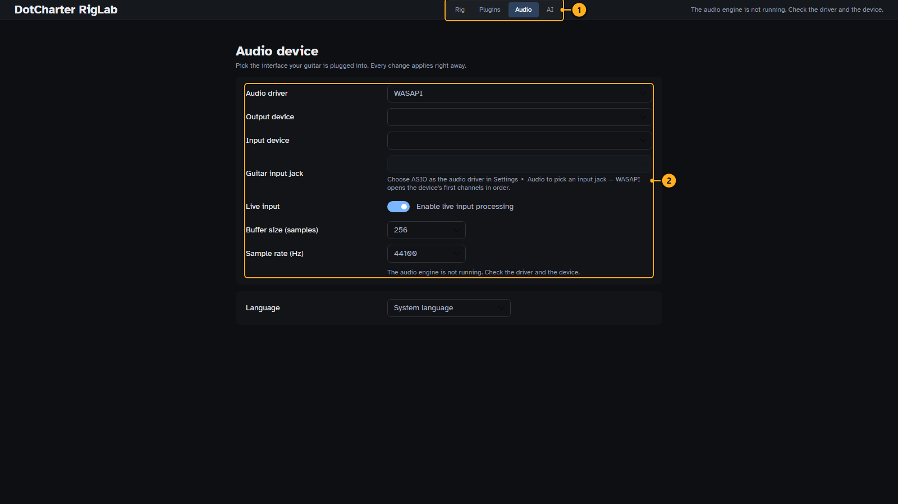
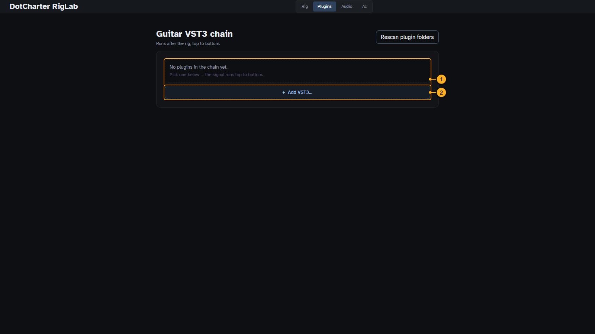
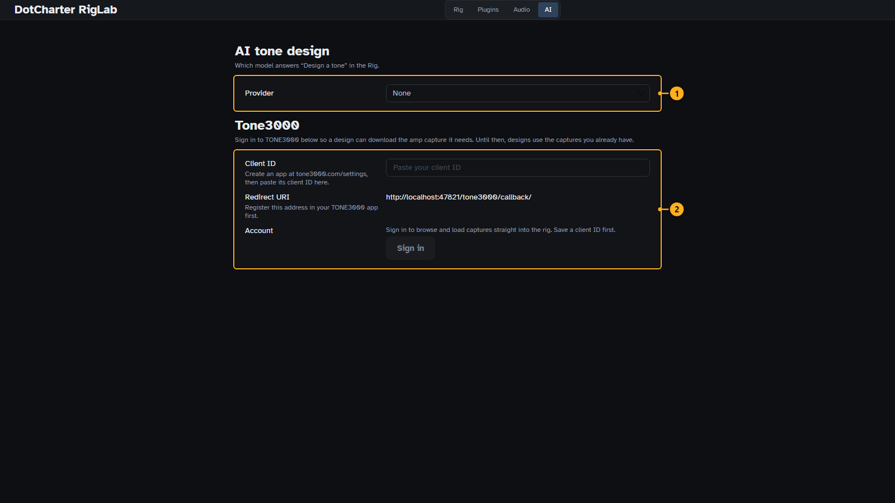

# Tone rig

The rig turns your dry instrument signal into a guitar or bass sound. It is a chain of pedals, amps,
cabinets and effects, all running live with low latency. It is the same rig in the editor, in Play
Mode and in RigLab. You can open it from the **Rig** row of the navigation rail, from **Tools ▸ Tones ▸
Rig…** in the editor, or from **Rig…** on Play Mode's Get ready and pause screens.

The rig needs a live instrument input (**Settings ▸ Audio ▸ Instrument input**).

## The rig

<!-- guide:callouts rig-overview -->
1. **Preset.** The tone's name. Click it to browse your tones. Save keeps it, and the arrows step through your presets.
2. **Compare.** Two versions of the tone, A and B, that you can switch between while you play.
3. **Bypass.** Plays your dry guitar, so you can hear what the rig adds.
4. **Scenes.** Up to eight variations of the tone. You switch them by click or MIDI.
5. **Editor.** The selected unit, with all its controls.
6. **Signal chain.** The units in the order your signal passes them. Drag to reorder them and click to edit.
7. **Routing.** Series, two lanes in parallel or three lanes in parallel.
8. **Gear.** Every amp, cabinet and effect. Add one with + or drag it onto the chain.
9. **Tuner.** A tuner that is always on.
10. **Meters.** Tempo for time-based effects, and input and output levels.
<!-- /guide:callouts -->

### Walkthrough: build a tone

1. Find an amp in **Gear**. Filter by type with the icons, or search. Press **+** to add it, or drag it
   onto the chain.
2. Add a cabinet after the amp. An amp alone sounds harsh, and the cabinet shapes it.
3. Add pedals before the amp, such as drive, compressor or wah. Add time-based effects after the
   cabinet, such as chorus, delay or reverb. Drag units to change their order.
4. Click a unit to edit it in the editor above the chain. Double-click a control to reset it.
5. Try a variation on **B** and switch between **A** and **B** while you play. You can also keep up to
   eight variations as **Scenes**.
6. **Save** the tone under a name.

Neural amp models (NAM) load a capture of a real amp. Once you sign in under **Settings ▸ Tone3000**,
you can download community captures.

## Tones

The preset name in the header, **Tones**, opens the tone browser.

<!-- guide:callouts rig-tones -->
1. **Tones.** Your saved tones and the song's tones. Pick one to load it.
2. **Search.** Finds a tone by name.
3. **Collections.** Your tones, the song's tones and the presets, sorted by group.
4. **Save.** Saves the current rig as a tone.
<!-- /guide:callouts -->

## RigLab

RigLab is the rig as an application of its own. Use it when you only want to play through your tones
without the editor. It is its own download, `DotCharter-RigLab-v<version>.zip`, next to DotCharter. Its
**Rig** tab is the rig shown above. The other tabs are below.

<!-- guide:callouts riglab-audio -->
1. **Tabs.** RigLab is the rig on its own, without the editor. Its tabs are Rig, Plugins, Audio and AI.
2. **Audio.** Driver, devices, input channels, sample rate and buffer size.
<!-- /guide:callouts -->

<!-- guide:callouts riglab-plugins -->
1. **Plugins.** The VST3 plugins in the rig's chain.
2. **Add plugin.** Picks a VST3 plugin to add.
<!-- /guide:callouts -->

<!-- guide:callouts riglab-ai -->
1. **AI provider.** Which AI model designs tones for you.
2. **Tone3000.** Signs you in to download community amp captures.
<!-- /guide:callouts -->

Next: [Settings reference](settings.md).
